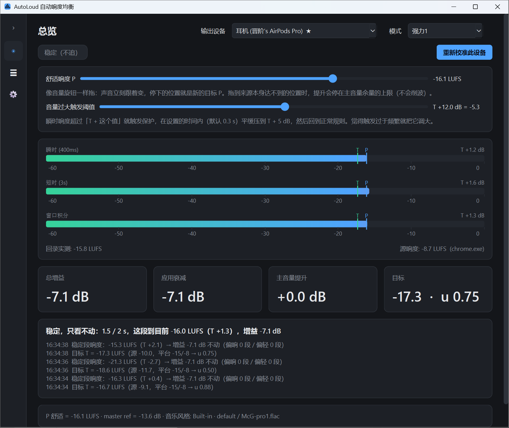

# AutoLoud

**Calibrate once; never touch the volume again when switching videos or apps.**

AutoLoud levels every sound on Windows to the comfortable loudness you calibrated. No driver, no audio-stream interception: it measures how loud the system output is in real time (ITU-R BS.1770 LUFS) and quietly adjusts each application's volume so the result lands on your target.



## Install

1. Download the latest `AutoLoud.exe` from [Releases](../../releases) (single file, ~100 MB, no Python needed).
2. Run it. On first launch SmartScreen may warn — choose "More info → Run anyway". The exe is not code-signed.
3. The UI follows your Windows display language (Chinese → 中文, otherwise English); change it any time in Settings.
4. The calibration wizard opens automatically; it takes about two minutes. AutoLoud then lives in the tray.

## What it does

- **Onset guard**: when sound appears after silence, playback starts 10 dB under the target T and ramps up to T over one block length (2 s by default), only ever cutting, never boosting a quiet intro. A sudden loud notification never blasts you.
- **Two reference levels**: P (human preference loudness, what you calibrated / set with the slider) and T (target loudness, what the rules actually aim at). In the normal modes T = P; in the 强力1 mode T is learned and slides within [P − X, P] with the app's own loudness. Every "T ± n" below is "P ± n" in the normal modes.
- **Listen, then nudge**: after that, every 2 s of listening leads to one decision: too quiet → up by at most 1.3 dB; too loud → down by at most 2 dB, except a new work's first cut, which goes all the way; within 3 dB of T a step goes exactly to T; each ramped over one block length; up to 2 dB above or 3 dB below T counts as comfortable and it stops.
- **Comfortable means hands off**: quiet dialogue, interludes and fade-outs are left alone; only a block above T + 4.5 dB, or 3 consecutive blocks below T − 16 dB, restart the adjustment (强力1 preset: 2 blocks above T + 5, or 4 below T − 6).
- **New work, same gain**: a track or video change (system media info, or sound after 15 s of silence) resumes at the gain that app had last time, then nudges from there; only apps never heard before go through the onset guard.
- **Sudden loudness**: momentary loudness above T + 14 dB (adjustable on the dashboard) is cut down to T + 2 dB within 0.05 s (adjustable); once landed, the normal rules resume by themselves. No pop-up.
- **Tool apps excluded automatically**: a session that stays active but hardly ever sounds (IME key clicks, notification helpers) is tagged "tool app" and takes no part in the levelling or the detection.
- **Modes and per-app presets**: the dashboard picks a parameter preset as the current "mode" (three ship: 默认 / 强力 / 强力1; more on the Settings page); in the mixer each app can choose the preset the bus runs with while that app sounds alone. Two "strong" switches live in a preset: "cut pulls fader" (every protection cut pulls the app's fader down by the excess over T − 5 dB, for good) and "target = follow source loudness" (强力1: the target T slides between P − X and P with the app's own loudness, learned from its quiet and loud platforms; X = 5 LU).
- **Per-app mixer**: every app that produces sound gets a fader (mute to +15 dB) on top of the bus; a fader above 0 dB is realised by raising the master and pulling the other apps down.
- **Volume keys move P**: keyboard volume keys and external volume knobs adjust the comfort level P (1 dB per press) instead of the Windows master volume; can be turned off in Settings.
- **Restores everything**: on exit all app volumes and the master volume return to where they were.

## Calibration

One step: set your external device (headphone amp / speakers / Bluetooth headset) and the Windows master volume to about 80 %, then play music you like — a bundled track, or your own in any app (Spotify, a browser…) selected in the wizard — and slowly raise the fader from 0 to the level you find comfortable. That is your comfort level P.

Each output device keeps its own calibration. Leave the external device and the master volume alone afterwards — AutoLoud uses them as the reference; P itself can be fine-tuned any time with the dashboard slider.

## Run from source / build

Python 3.10+. In PowerShell:

```
.\dev.bat                # venv, dependencies, run from source
.\build.bat              # build dist\AutoLoud.exe
python run.py --mock     # any OS: run the UI on a software simulator
python -m pytest -q      # tests: LUFS vs pyloudnorm, closed-loop controller simulation
```

`.github/workflows/build.yml` runs the tests and builds the exe on every push; a `v*` tag publishes a Release.

## How it works

Windows audio engine → per-app session mix → WASAPI loopback capture → BS.1770 meter → gain controller → per-app session volume (≤ 0 dB) and endpoint volume (only above the calibration reference when a boost is needed). See `autoloud/dsp/loudness.py`, `autoloud/core/controller.py`, `autoloud/core/engine.py`, `autoloud/backends/windows.py`.

## License

[CC BY-NC 4.0](LICENSE) — free to use, modify and share with attribution; no commercial use.
