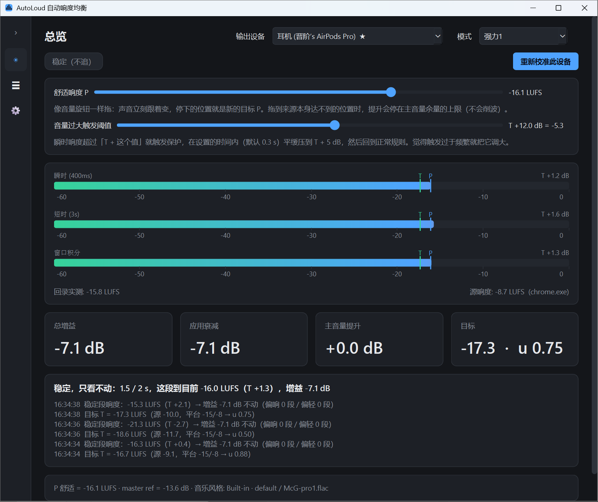
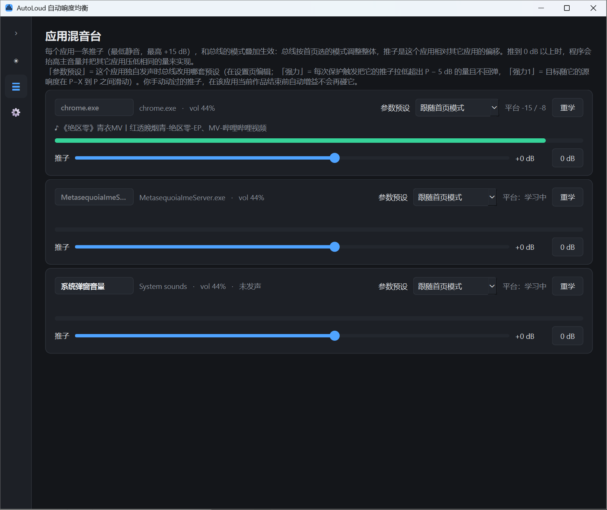

<div align="center">

# AutoLoud

**一度だけ合わせてください。あとは AutoLoud にお任せを。**
*You adjust once. We handle the rest.*

[简体中文](README.md) · [English](README.en.md) · [**日本語**](README.ja.md) · [한국어](README.ko.md) · [Русский](README.ru.md)

</div>

AutoLoud は新しい時代の音量コントロールを定義し直します。覚えることは何もありません。インストールしたら、いつも通りに音量を調整するだけ。あなたが好むラウドネスを自動で学び、これから鳴るすべての音を心地よい範囲に収めます。手動で音量を触る回数を大きく減らしながら、良質なコンテンツ本来のダイナミクスは保ちます。



## なぜ AutoLoud なのか

一日に何回、音量調整に注意を奪われているか考えたことはありますか。

新しい動画を開くと急に大きくなり、次の曲は小さすぎて聞こえない。ゲームのセリフをちょうどよい音量に合わせた途端、次の戦闘で耳をつんざく。

私たちが何度も音量を触るのは、ほぼ同じ目的のためです。「心地よく聞こえてほしい」。

AutoLoud はその目的を直接伝えられるようにします。いつもの音量操作で「この大きさが好き」と教えれば、以降は学習と調整を続け、あなたの注意をコンテンツそのものに残します。

## ダウンロードとインストール

1. [Releases](https://github.com/SparrowReivun/AutoLoud/releases) から最新の `AutoLoud-windows.zip` をダウンロードします（約 100 MB、Python 不要）。
2. 任意のフォルダに展開し、中の `AutoLoud.exe` を実行します（フォルダはそのまま保ってください。exe の隣のファイルはすべて必要です）。初回は Windows SmartScreen が「Windows によって PC が保護されました」と表示することがあります。「詳細情報 → 実行」を選んでください。
3. キャリブレーションは不要です。何か再生して、ダッシュボードの「快適ラウドネス P」スライダー（0～100 %）を心地よい位置に動かすだけ。あとは音量キー / ノブで微調整できます。AutoLoud はトレイに収まって静かに動作します（「Windows 起動時に開始」にチェックを推奨）。設定はプログラム フォルダーの `config.json` に保存されるので、フォルダーごとコピーすれば別の PC でも引き継がれます。

**ウイルス対策ソフトの警告について**：AutoLoud はコード署名をしていません（証明書は有料です）。さらに音量キーの横取り（グローバル キーボード フック）、システム ループバックの取得、各アプリの音量制御を行います。この組み合わせが、まだ評判のない新しいプログラムで動くと、Defender や 360 などのヒューリスティックがトロイの木馬と誤判定することがあります。オープンソースなので、ソースと照合するか、exe を VirusTotal で確認してください。リリースごとに Microsoft へ誤検知の申告を行っています。不安であれば、下記の「ソースから実行」で動かすこともできます。

UI の言語は Windows の表示言語に合わせて中国語または英語が選ばれ、設定ページで切り替えられます。

## 設計の基本理念

### 1. 操作駆動から目標駆動へ

従来の音量制御は受動的な修正です。大きすぎる・小さすぎると気づいてから手で直す。その操作が解決するのは、たいてい目の前の問題だけです。

AutoLoud は音量操作を「好みの情報」として扱います。操作は現在の音量を変えると同時に、あなたが求める聴感をシステムに伝え、その目標は以降の再生にも引き継がれます。

### 2. 全体の聴感は安定させ、ダイナミクスは保つ

静かな場面とクライマックス、ささやくセリフと激しい戦闘には、本来強弱の差があるべきです。すべてを同じラウドネスに揃えると、その差が失われ、不自然に聞こえがちです。

AutoLoud の目標は、不快なラウドネス差を減らしつつ、作品本来のダイナミクスをできるだけ残すことです。

- 静かな部分は静かなまま。
- 激しい場面の迫力はそのまま。
- 全体がより心地よい範囲に収まる。

### 3. よく聴き、あまり動かさない

自動制御には即応性が必要ですが、抑制も必要です。一瞬の爆発音や一言の小声が、全体の音量を動かすべきではありません。

AutoLoud は定常状態の仕組みを使います。新しいコンテンツが始まったら、速く滑らかに適切なゲインを探す。定常状態に入ったら、再調整の敷居を上げる。

現在の設計では約 2 秒を分析ブロックとし、連続する複数のブロックがすべて大きすぎる、またはすべて小さすぎると示したときだけ定常状態を離れて再調整します。

常に分析し、慎重に調整する。

### 4. 固定目標ではなく、ラウドネス分布を学ぶ

同じアプリの中にも、穏やかな内容と激しい内容が混在します。ユーザーの好みのラウドネスの周りに固定の帯を設けるだけでは、正常な強弱の変化に干渉してしまいます。

初期のバージョンでは狭い固定の帯にラウドネスを収めようとしました。実際のテストを経て、プロジェクトは各アプリのラウドネス履歴に基づく制御へ移行し、強さの異なる内容にそれぞれ異なる目標ラウドネスを与えるようになりました。

AutoLoud は各アプリのソース ラウドネス分布を少しずつ学び、ユーザーの好みと組み合わせて、各レベルを対応する目標範囲に写像します。

### 5. 聴覚の保護

大きすぎる音は自動で抑え、聴覚の健康を守ります。

### 6. アプリごとの音量権限

各ソフトの音に対するコントロールを取り戻します。特に WeChat のように通知音が大きすぎるのに音量設定を持たないソフトに有効です。アプリごとに個別かつ恒久的な音量の好みを設定でき、突然の着信音の轟音とはお別れです。上級ユーザー向けの豊富なカスタマイズ用インターフェースも用意しています。

### 7. すべての人に音の心地よさを

音量調整のことも、このソフトの存在さえも、すっかり忘れてしまえるように。

## 仕組み

### 各アプリのラウドネス特性を学ぶ

一つのアプリだけが鳴っているとき、システムは全ゲインを除いたソース ラウドネス L_src を逆算し、そのアプリの二つの基準値を更新します。

| パラメータ | 意味 |
| --- | --- |
| C_low | 過去のソース ラウドネスの第 20 百分位。静かめのレベルを表す |
| C_high | 過去のソース ラウドネスの第 80 百分位。大きめのレベルを表す |

学習は有効な発音時間で数え、半減期は約 20 分です。二つの基準値はミキサーで確認でき、手動で学び直すこともできます。



### 目標ラウドネスの計算

各リスニング ブロックの終わりに、現在のソース ラウドネスが二つの基準値の間のどこにあるかを計算します。

```
u = clip((L_src - C_low) / (C_high - C_low), 0, 1)
T = (P - X) + X × u
```

ここで、

| パラメータ | 意味 |
| --- | --- |
| P | ユーザーの好みのラウドネス（human preference loudness） |
| X | 目標ラウドネスが動く幅 |
| u | 学習した範囲の中での現在のソース ラウドネスの相対位置（0〜1 に制限） |
| T | 現在の目標ラウドネス（target loudness） |

ソース ラウドネスが静かな基準値に近いとき目標は P − X に近づき、大きな基準値に近いとき P に近づきます。大きな基準値を超えても目標は P のままです。

ここで制限されるのは目標ラウドネスです。短い音の実際の振る舞いは、コントローラの応答と定常状態の仕組みにも依存します。

### フォールバックと学び直し

学習不足、複数アプリの混合、アプリ内の音量変更に対応するため、現在の実装は次の規則を使います。

| 状況 | 処理 |
| --- | --- |
| 有効な学習時間が 30 秒未満 | 当面 T = P |
| 二つの基準値の差が 1 LU 未満 | 当面 T = P |
| 複数のアプリが同時に鳴っている | ソース ラウドネスの学習を止め、直前の目標を保持 |
| 60 秒間有効なソース ラウドネスが得られない | 目標を P に戻す |
| ソース ラウドネスが 2 分間 C_low より 6 LU 以上低い | その 2 分のデータで基準値を作り直し、アプリ内音量の変更などに追従 |

## Windows オーディオ側の仕組み（開発者向け）

```
Windows オーディオ エンジン ──► 各アプリ セッションのミックス ──► WASAPI ループバック キャプチャ ──► BS.1770 LUFS リアルタイム測定
                                   ▲                                                              │
                                   │ ISimpleAudioVolume（各アプリのセッション音量、≤ 0 dB）              │
                                   └──────────────────── ゲイン コントローラ ◄──────────────────────┘
                                                            │
                           IAudioEndpointVolume（マスター音量。ブーストが必要なときだけ校正基準より上げる）
```

- `autoloud/dsp/loudness.py` — ストリーミング BS.1770-4：K 特性、モーメンタリ / ショートターム / ゲート付き統合ラウドネス。pyloudnorm との差は 0.2 LU 未満。
- `autoloud/core/controller.py` — 純ロジックのゲイン コントローラ（IDLE → ONSET → ADJUST → STEADY → SAFETY）。オフラインでシミュレーション可能。
- `autoloud/core/platforms.py` — アプリごとのソース ラウドネス分布（C_low / C_high）の学習。
- `autoloud/core/engine.py` — キャプチャ → 測定 → 判断 → 音量適用。マスター音量の可視性検出、ソース ラウドネスの逆算。
- `autoloud/backends/windows.py` — PyAudioWPatch（ループバック）+ pycaw（音量）。COM 呼び出しはすべて一つのスレッドに集約。
- `autoloud/backends/mock.py` — 同じインターフェースのソフトウェア シミュレータ。
- `autoloud/ui/` — PySide6 の UI：ダッシュボード、アプリ ミキサー、設定、トレイ。

この「聴いて音量を制御する」方式はオーディオ ストリームを置き換えないため、サンプル単位のリミッティングや圧縮はできません。その代わりドライバ不要、遅延ゼロで、どのアプリが鳴っているかを常に把握できます。`Backend` インターフェースは将来の仮想サウンド カード バックエンドに備えてあります。

ソースから実行：`pip install -r requirements.txt && python run.py`。テスト：`pip install -r requirements-dev.txt && pytest`。

## ログ

ログはすべてプログラムの隣の `logs\` フォルダー（展開後の `AutoLoud\logs\`、ソースから実行した場合はプロジェクト内の `logs\`。書き込めない場合のみ `%APPDATA%\AutoLoud\`）。起動のたび、またダッシュボードでモード（監視のみ / 既定 / 強力 / 強力1 …）を切り替えるたびに新しいファイル一式を開き、名前にモードの英語タグが付きます（`volume-20261103-121622-monitor.csv`、`meters-20261103-130501-strong1.csv`）。つまり 1 ファイル＝1 条件です。`autoloud.log` は実行ログ。`adjust-<時刻>.log` は各実行の音量判断の記録で、ダッシュボードのアクティビティ カードと同じ文言、各行にその時点で鳴っていたアプリ付き。`meters-<時刻>.csv`（100 ms ごとに 1 行：モーメンタリ / ショートターム / ウィンドウ統合 LUFS、サンプル ピーク、総ゲイン、セッション減衰、マスター ブースト、状態、P、マスター音量、その時点で唯一鳴っていたアプリ、目標 T）と `apps-<時刻>.csv`（0.5 秒ごと、鳴っているアプリごとに 1 行：ピーク メータ、セッション音量、バス ゲイン、フェーダー、および単独で鳴っているときの全ゲイン除去後のソース ラウドネス `src_momentary_lufs` / `src_short_lufs`）は分析用の生データです。これらのファイルは自動削除されません。

あるアプリの一回の実行での履歴を見るには、`pip install pandas matplotlib` の後に `python tools\plot_app.py ZenlessZoneZero.exe` を実行します（既定は最新の実行、実行時刻を指定可能）。カレント フォルダに `<アプリ>-<時刻>.png` を書き出し、同じ時間軸の 4 枚のパネルを描きます：アプリのピーク メータ（dBFS）とセッション音量；バスのモーメンタリ / ショートターム / 統合の知覚ラウドネスと P（緑はこのアプリだけが鳴っていた区間。このときバスのラウドネスがそのアプリのラウドネスです。プログラムはミックス全体の LUFS を測るだけで、アプリ別の LUFS はありません）；アプリ自身のソース ラウドネス（バス ゲイン、フェーダー、セッション音量を除いた、セッション音量 100 %・基準マスターでの値。単独で鳴っていた区間のみ）；バス ゲイン、フェーダー、セッション音量。

AutoLoud の有無でユーザーが音量を動かした回数を比べるには `python tools\plot_volume.py`（既定は最新の実行）。`volume-<時刻>.png` を書き出し、上段はユーザーが操作するレベル（監視のみの区間は Windows マスター音量＝青と音量キー＝赤 / スライダー＝緑の各操作、自動プリセットの区間は P＝橙と P スライダー・音量キー・フェーダーの各操作）、下段は AutoLoud 自身の自動ゲイン（紫）と目標 T（緑の破線、監視のみの区間は何も動かさないので空）。横軸の下にはその時の Chrome のタブ名（`--titles` で別アプリに変更可）を並べ、操作の固まりを再生中の曲と突き合わせられます。

## 開発とテストの状況

AutoLoud は現在も開発とチューニングを続けています。

ここ数週間で、開発・テスト・反復に 200 時間以上を費やし、二つの候補バージョンを作り、ゲーム・音楽・動画の場面で数十時間の使用テストを行いました。テスト済みの場面では、どちらのバージョンも全体として良好に動作しています。

開発者自身の使用では、数時間連続のセッションで開始時に一度だけ音量を合わせ、その後は手動介入が不要だった例があります。これは現在のテスト条件下での個人的な観察で、すべてのデバイス、アプリ、ユーザーの体験を代表するものではありません。

今後の検証では次の点に注目します。

- 手動の音量調整回数が減るか。
- 新しいコンテンツの開始から定常状態に入るまでの時間。
- 唐突または不要なゲイン変化が起きないか。
- 作品のダイナミクスがどの程度保たれるか。
- 複数のアプリが同時に鳴るときの制御品質。

## ライセンス

[CC BY-NC 4.0](LICENSE) — 表示を条件に自由に使用・改変・共有できます。商用利用は禁止です。同梱のデモ曲 `McG-pro1` はキャリブレーションのデモ専用です。

AutoLoud は QMUL C4DM（Centre for Digital Music）の自動ミキシング研究に基づいています。
