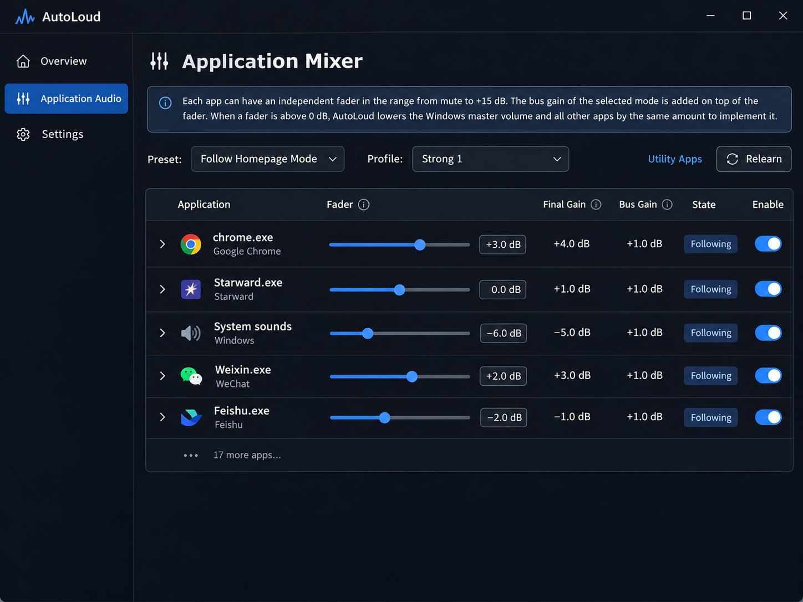
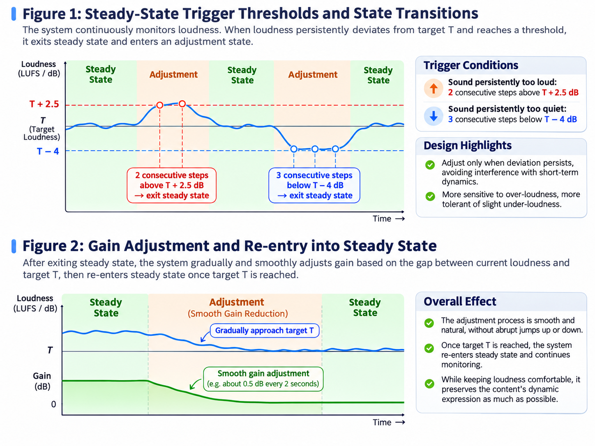
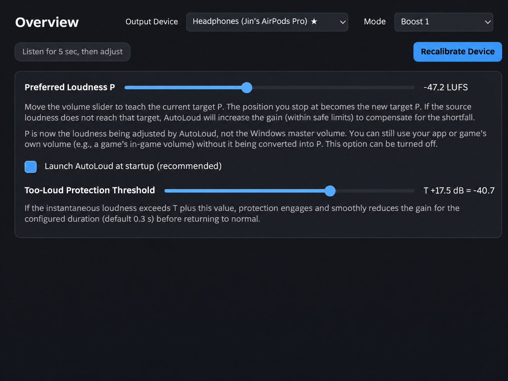
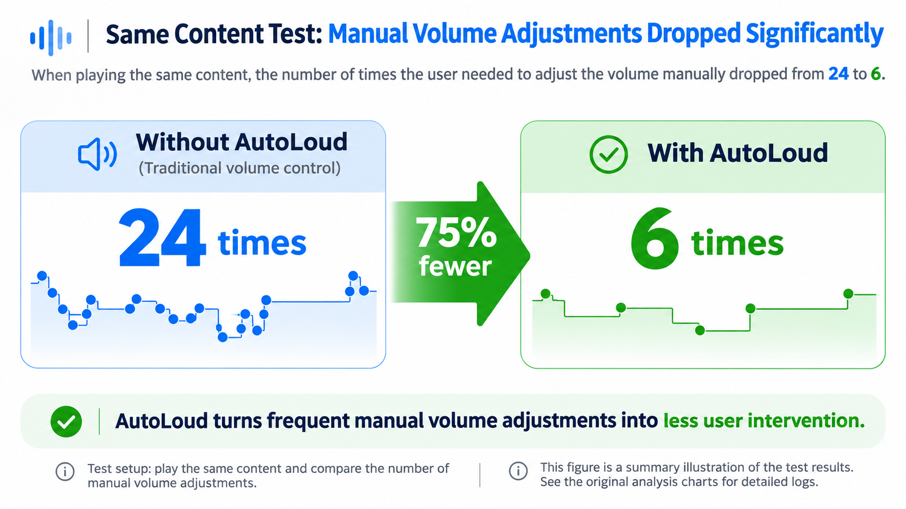
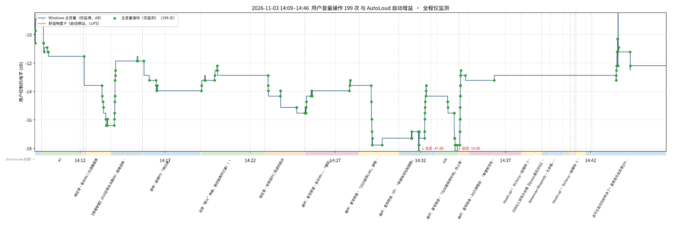
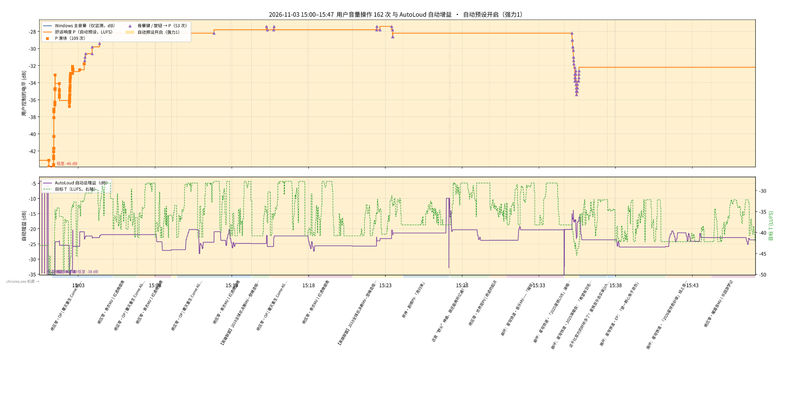

<div align="center">

# AutoLoud

### 반복적인 볼륨 조절에서 언제나 편안한 청취로.

**이제 볼륨 걱정 없이 소리 자체를 즐기세요.**

*You adjust once. We handle the rest.*

[简体中文](README.md) · [English](README.en.md) · [日本語](README.ja.md) · [**한국어**](README.ko.md) · [Русский](README.ru.md) · [최신 버전 다운로드](https://github.com/SparrowReivun/AutoLoud/releases) · [문제 제보](https://github.com/SparrowReivun/AutoLoud/issues)

</div>

## Why AutoLoud?

우리는 하루에 볼륨을 몇 번이나 조절할까요?

영상에서 음악으로 바꿀 때마다, 게임 속 장면이 달라질 때마다 대사는 너무 작고 음악은 너무 큰 상황을 반복합니다. 사무실 전체에 들릴 만큼 크게 울리는 WeChat 알림음은 말할 것도 없죠.

우리는 100년이 넘도록 볼륨을 올리고 내리는 조작을 반복해 왔습니다. 하지만 대부분의 경우 목적은 단 하나입니다.

**소리를 편안하게 듣고 싶은 것.**

그렇다면 우리가 좋아하는 음량을 기기에 한 번 알려 주고, 나머지는 기기가 알아서 처리하게 할 수는 없을까요?

AutoLoud는 바로 이 문제를 해결하고자 합니다.

새로운 조작을 배울 필요는 없습니다. 평소처럼 볼륨 키를 사용하세요. 차이점은 이번에는 볼륨 조절이 현재 음량을 바꾸는 데 그치지 않고 AutoLoud에 사용자의 취향까지 알려 준다는 것입니다.

> **“나는 이 정도 음량이 좋아.”**

AutoLoud는 개인 사운드 도우미처럼 청취 취향을 꾸준히 학습하고 기억합니다. 콘텐츠마다 다른 라우드니스에 맞춰 음량을 자동 조정하여 사용자가 듣고 있는 음악, 영상, 게임에 더 집중할 수 있도록 돕습니다.

*“Every volume adjustment teaches your device what you like.”*

---

## 다운로드 및 설치

1. [Releases](https://github.com/SparrowReivun/AutoLoud/releases)에서 최신 `AutoLoud-windows.zip`을 다운로드하세요(약 100 MB, Python 설치 불필요).
2. 원하는 폴더에 압축을 풀고 `AutoLoud.exe`를 실행하세요. **압축을 푼 폴더 전체를 유지해야 합니다.** 실행 파일 옆의 다른 파일들도 필요합니다.
3. 처음 실행하기 전에 헤드폰이나 스피커를 연결하고 정상적으로 소리가 나오는지 확인하세요. 화면의 안내에 따라 초기 설정을 마치면 됩니다.

**첫 실행 시 보안 안내:** Windows SmartScreen에서 “Windows의 PC 보호” 경고가 나타날 수 있습니다. 먼저 파일이 프로젝트의 공식 Releases 페이지에서 다운로드한 것인지 확인하세요. 신뢰할 수 있는 파일이라고 판단한 경우 “추가 정보 → 실행”을 선택할 수 있습니다.

**백신 프로그램 경고:** AutoLoud는 현재 코드 서명을 신청하는 단계입니다. 볼륨 키 입력을 감지하고, 시스템 루프백 오디오를 캡처하며, 개별 애플리케이션의 볼륨을 제어하기 때문에 Microsoft Defender나 360 등의 휴리스틱 탐지에서 오탐지될 수 있습니다. 프로젝트는 오픈 소스이므로 코드를 살펴보거나 [VirusTotal](https://www.virustotal.com/)에서 파일을 검사할 수 있습니다. 우려된다면 [소스 코드로 직접 실행](#소스-코드로-실행하기개발자용)할 수도 있습니다.

**출력 장치를 찾을 수 없나요?** 특히 Bluetooth 헤드폰에서 발생할 수 있습니다. Windows에서 원하는 장치를 먼저 선택한 뒤 AutoLoud의 장치 목록을 새로 고쳐 보세요. 필요하다면 AutoLoud를 다시 실행하세요.

**언어:** Windows 표시 언어에 따라 중국어 또는 영어가 자동으로 선택됩니다. 설정 화면 맨 아래에서 수동으로 변경할 수도 있습니다.


## 1. 설치 후 사용 방법

AutoLoud의 목표 중 하나는 **새로 배워야 할 조작을 만들지 않는 것**입니다.

프로그램을 실행하면 AutoLoud가 시스템 볼륨 제어의 일부를 담당하지만, 사용 방식은 그대로입니다. 볼륨 노브, 키보드의 볼륨 키, 프로그램의 슬라이더를 계속 사용하면 됩니다.

AutoLoud는 사용자의 조절 동작을 **선호 라우드니스 P(Preference Loudness)**로 기록하고, 각 애플리케이션의 라우드니스 특성을 학습합니다.

학습이 진행되면 다음과 같은 차이에 점차 적응합니다.

- 음악과 영상 사이의 라우드니스 차이
- 게임 속 작은 대사와 격렬한 전투음의 차이
- 애플리케이션별 일반적인 음량 특성
- 콘텐츠 내 자연스러운 다이내믹 변화
- 개별 조절이 어려운 알림음

무엇보다 중요한 점은 AutoLoud가 **모든 소리를 무조건 같은 크기로 평탄화하지 않는다**는 것입니다.

자동 믹싱 분야의 연구를 바탕으로 전체 라우드니스를 제어하면서도 창작자의 의도를 최대한 존중하고자 합니다. **조용한 부분은 조용하게, 강렬한 장면은 그 임팩트를 유지하도록** 설계했습니다.

또한 **애플리케이션별 믹서**를 제공하여 각 프로그램의 볼륨을 독립적으로 관리할 수 있습니다.



*그림: 애플리케이션별 독립 페이더와 제어 프리셋을 설정할 수 있는 믹서.*

## 2. 배경

### 2.1 볼륨 제어를 개선하려는 시도

재생 음량을 조절하려는 시도는 100년 넘게 이어져 왔습니다. 1902년에도 축음기의 구조를 개선해 출력 음량을 변화시키는 장치가 특허에 등장했습니다 [1].

오늘날 여러 산업과 기업은 콘텐츠 간 라우드니스 차이를 줄이고 편안한 청취 경험을 제공하는 일이 중요하다는 것을 알고 있습니다.

방송, 영화, 스트리밍 업계에는 ITU-R BS.1770과 EBU R 128 등의 라우드니스 표준이 도입되었습니다 [2][3]. Apple Music, YouTube, Spotify 역시 노래나 영상 사이의 라우드니스 차이를 줄이는 다양한 정규화 기능을 제공합니다 [4][5][6].

하지만 이러한 기능만으로 모든 상황을 해결할 수는 없습니다.

- **애플리케이션 사이의 차이:** 음악을 적당한 음량으로 듣다가 WeChat 알림이 갑자기 매우 크게 울릴 수 있습니다. 앱 안에서 알림음만 편리하게 조절할 수 없는 경우도 있습니다.
- **콘텐츠 내부의 큰 다이내믹 변화:** *젠레스 존 제로* 같은 게임에서 대사는 작고 전투 효과음은 지나치게 크게 느껴질 수 있습니다. 영상이나 음악에서도 비슷한 상황이 생깁니다.
- **앱과 콘텐츠 전환:** 음악, 영상, 게임 등으로 전환할 때 여전히 수동 조절이 필요합니다.

이러한 문제는 대부분 사용자가 직접 해결해야 합니다. 늦게 대응하면 활동이 방해받고 청각적 불편이 생기며, 소리가 매우 큰 경우에는 청력에 위험이 있을 수 있습니다 [7].

### 2.2 모든 소리를 같은 라우드니스로 만들면 안 될까요?

컴프레서나 자동 게인 제어를 이용해 비슷한 문제를 해결하려는 소프트웨어와 플러그인은 이미 있습니다. Waves Vocal Rider 등이 그 예입니다 [8].

AutoLoud 초기 버전에서도 소리의 라우드니스를 사용자가 설정한 고정 구간에 유지하는 방식을 시험했습니다.

하지만 실제 청취 테스트에서 문제가 드러났습니다.

**소리의 강약 자체가 작품 표현의 일부이기 때문입니다.**

음악에는 잔잔한 부분과 절정이 있고, 영화에는 작은 대사와 극적인 장면이 있으며, 게임도 소리의 변화를 통해 몰입감을 만듭니다.

모든 소리를 좁은 구간으로 강제하면 시스템이 게인을 끊임없이 조절해야 합니다. 이는 창작자가 의도한 다이내믹을 훼손하고 부자연스러운 청취 경험을 만들 수 있습니다.

따라서 진짜 과제는 모든 소리를 똑같이 크게 만드는 것이 아니라 다음 질문에 답하는 것입니다.

> **작품 본래의 다이내믹을 존중하면서도 다양한 콘텐츠를 가능한 한 편안한 음량으로 들을 수 있게 하려면 어떻게 해야 할까요?**

저는 여러 설계를 시험하고 **200시간 이상** 개발, 테스트, 개선을 반복한 끝에 현재 AutoLoud의 핵심 방식을 완성했습니다.

사용자 취향 학습, 앱별 라우드니스 분포 모델링, 동적 목표 라우드니스, 안정 상태 제어를 결합해 일상적인 음량 문제를 하나의 체계로 다룹니다.

*You adjust once. We handle the rest.*

## 3. 핵심 설계 원칙

AutoLoud의 장기적인 목표는 볼륨 제어의 새로운 방식을 탐구하는 것입니다.

기존 볼륨 제어는 사용자가 문제를 알아차리고 직접 수정해야 합니다. AutoLoud는 이를 사용자의 청취 목표를 계속 학습하고 능동적으로 적응하는 과정으로 바꾸고자 합니다.

설계의 핵심에는 세 가지 원칙이 있습니다.

### 3.1 조작 중심에서 목표 중심으로

기존 볼륨 조절은 반응적입니다. 너무 크거나 작은 소리를 들은 뒤 수동으로 고칩니다. 매번 눈앞의 문제만 해결하는 셈입니다.

하지만 볼륨을 조절하는 행동에는 사용자의 선호 정보도 담겨 있습니다.

AutoLoud는 이런 조작을 단순한 명령이 아니라 **선호 신호**로 해석합니다.

사용자가 편안한 수준으로 조절하면 당시의 오디오와 라우드니스를 기록하여 **선호 라우드니스 P**를 구하고, 이후 재생에서 참고합니다.

즉, “조금 크게”, “조금 작게”를 반복하는 대신 기기에 이렇게 알려 주는 것입니다.

> **“나는 이런 소리가 좋아.”**

### 3.2 창작자의 원래 의도 존중

**사용자 선호 라우드니스 P가 모든 소리를 P로 맞춰야 한다는 뜻은 아닙니다.**

이는 AutoLoud 초기 실험에서 얻은 중요한 결론입니다.

잔잔한 부분과 절정, 작은 대사와 격렬한 전투는 본래 소리의 크기가 달라야 합니다. 사용자가 한 번 음량을 조절했다는 것은 **지금 듣는 부분**에 대한 선호를 표현한 것이지, 작품 전체를 같은 수준으로 맞춰 달라는 의미는 아닙니다.

그렇기 때문에 P를 중심으로 고정된 편안한 구간을 정하면 딜레마가 생깁니다.

- **구간이 너무 좁으면:** 정상적인 다이내믹에도 빈번하게 개입해 조용한 부분과 큰 부분의 차이를 줄이고 작품의 의도를 훼손합니다.
- **구간이 너무 넓으면:** 다이내믹은 보존할 수 있지만 지나치게 크거나 작은 소리를 충분히 제어하지 못해 수동 조절이 계속 필요합니다.

이 문제를 해결하기 위해 AutoLoud는 **동적 목표 라우드니스 T(Target Loudness)**를 도입했습니다.

모든 소리를 하나의 고정 구간에 가두는 대신, 앱의 과거 라우드니스 분포, 현재 소리가 분포 안에서 차지하는 위치, 사용자 선호 P를 결합해 콘텐츠에 맞는 목표를 계산합니다.

그 결과 수동 조절은 줄이면서 작품의 다이내믹을 최대한 유지하고자 합니다. **조용한 부분은 여전히 조용하고, 격렬한 장면은 박진감을 유지하며, 전체 음량은 가능한 한 사용자의 취향에 가까워지도록** 합니다.

### 3.3 안정 상태 설계: 많이 듣고 적게 움직이기

자동 제어는 빠르게 반응해야 하지만, 불필요한 개입을 자제하는 것도 중요합니다.

라우드니스가 조금 바뀔 때마다 게인을 조절하면 빈번한 음량 변동이나 부자연스러운 ‘펌핑’이 생길 수 있습니다.

그래서 AutoLoud는 **안정 상태(Steady State)** 메커니즘을 도입했습니다.

원칙은 다음과 같습니다.

> **계속 관찰하되 필요한 때만 조절한다. 올릴 때는 신중하게, 내릴 때는 더 빠르게.**

합리적인 범위에서는 소리가 잠시 작은 편이 갑자기 지나치게 큰 소리보다 더 쉽게 받아들여질 수 있습니다.

따라서 지나치게 큰 소리에는 더 민감하게 반응하고, 작은 소리에는 상대적으로 관대하게 대응합니다.

한 번 편안한 상태에 들어가면 불필요한 게인 조절을 줄이고, 편차가 지속될 때만 새로운 안정 상태를 찾습니다.

## 4. 핵심 기술 설계

### 4.1 하나의 공통 모델 대신 애플리케이션별로 학습하기

음악 플레이어, 동영상 서비스, 게임, 메신저는 라우드니스 분포와 다이내믹 특성이 서로 다릅니다.

같은 애플리케이션 안에서도 작품별로 소리 특성이 크게 다를 수 있습니다.

이상적으로는 개별 작품의 라우드니스 분포를 학습하고 싶지만, 그러려면 많은 기록을 저장·관리해야 합니다. 또한 현재 사용 가능한 인터페이스로는 Apple Music 등 일부 앱에서 재생 중인 작품 정보를 안정적으로 가져오기 어렵습니다.

따라서 현 버전은 현실적인 방식을 채택했습니다.

**애플리케이션별 과거 라우드니스 분포를 학습한 뒤, 사용자 선호와 결합해 현재 목표를 계산합니다.**

작품 정보를 얻을 수 있는 경우에는 새로운 콘텐츠의 시작을 판단하는 데 보조적으로 활용합니다.

앱별 믹서는 알림음이 크거나 개별 제어가 불편한 앱의 음량을 따로 설정하는 데도 도움이 됩니다.

### 4.2 애플리케이션의 원본 라우드니스 분포 학습

실제로 소리를 내는 애플리케이션이 하나뿐일 때 AutoLoud는 적용된 모든 게인의 영향을 되돌린 **원본 라우드니스 `L_src`**를 추정할 수 있습니다.

그 값으로부터 해당 애플리케이션의 과거 분포에서 두 기준점을 학습합니다.

- **C_low:** 20백분위수로, 상대적으로 조용한 구간을 나타냅니다.
- **C_high:** 80백분위수로, 상대적으로 큰 구간을 나타냅니다.

기준값은 고정되지 않으며 앱 사용에 따라 계속 갱신됩니다.

학습 시간은 실제로 소리가 출력된 시간만 계산하고, 반감기는 약 **20분**으로 설정했습니다. 이전 기록을 유지하면서도 사용 방식의 변화에 적응하기 위해서입니다.

두 기준값은 믹서에서 확인하거나 초기화 후 다시 학습할 수 있습니다.

데이터 부족과 불안정한 분포에 대비해 다음 규칙을 적용합니다.

- 유효 학습 데이터가 **30초 미만**이면 임시로 P를 목표로 사용합니다.
- C_low와 C_high의 차이가 **1 LU 미만**이어도 P를 사용합니다.
- 여러 앱이 동시에 소리를 내 개별 원본 라우드니스를 정확히 추정할 수 없으면 이전 T를 유지합니다. **60초** 동안 유효한 측정값이 없으면 P로 돌아갑니다.
- 앱 내부 볼륨을 낮추는 등의 이유로 원본 라우드니스가 **2분 연속 C_low보다 6 LU 넘게 낮으면**, 그 2분간의 데이터로 기준 분포를 재구성합니다.

### 4.3 동적 목표 라우드니스 T 계산

분포를 학습한 다음에는 현재 원본 라우드니스가 두 기준값 사이에서 어느 위치에 있는지 계산합니다.

```math
u=\mathrm{clip}\left(\frac{L_{\mathrm{src}}-C_{\mathrm{low}}}{C_{\mathrm{high}}-C_{\mathrm{low}}},0,1\right)
```

여기서 `clip`은 결과를 0과 1 사이로 제한하는 함수입니다.

이후 선호 라우드니스 P와 동적 범위 매개변수 X를 이용해 목표 T를 계산합니다.

```math
T=(P-X)+X\cdot u
```

| 기호 | 의미 |
| --- | --- |
| P | 사용자 선호 라우드니스 |
| X | 목표가 P보다 낮아질 수 있는 최대 폭 |
| L_src | 적용된 게인을 제거한 앱의 원본 라우드니스 |
| C_low | 과거 원본 라우드니스의 20백분위수 |
| C_high | 과거 원본 라우드니스의 80백분위수 |
| u | 두 기준값 사이에서 현재 원본 라우드니스의 상대 위치 |
| T | 현재 목표 라우드니스 |

따라서 다음과 같습니다.

- 조용한 기준값에 가까우면 T는 P − X에 가까워집니다.
- 큰 기준값에 가까우면 T는 P에 가까워집니다.
- 원본 라우드니스가 더 커져도 T는 P를 넘지 않습니다.

**여기서 제한하는 것은 목표 T이지, 매 순간의 실제 출력 크기에 대한 엄격한 상한이 아닙니다.** 실제 게인 변화는 뒤에서 설명할 안정 상태 제어에도 영향을 받습니다.

#### 계산 예시

어떤 앱의 두 기준값이 다음과 같다고 가정합니다.

```math
C_{\mathrm{low}}=-25\ \mathrm{LUFS}, \qquad C_{\mathrm{high}}=-17\ \mathrm{LUFS}
```

차이는 8 LU이므로,

```math
u=\mathrm{clip}\left(\frac{L_{\mathrm{src}}+25}{8},0,1\right)
```

사용자의 설정이 다음과 같다면,

```math
P=-25\ \mathrm{LUFS}, \qquad X=6\ \mathrm{LU}
```

목표는 다음과 같습니다.

```math
T=-31+6u
```

| 현재 원본 라우드니스 | 상대 위치 u | 목표 T |
| --- | ---: | ---: |
| −25 LUFS | 0 | −31 LUFS |
| −23 LUFS | 0.25 | −29.5 LUFS |
| −21 LUFS | 0.5 | −28 LUFS |
| −19 LUFS | 0.75 | −26.5 LUFS |
| −17 LUFS | 1 | −25 LUFS |
| −5 LUFS | 1 | −25 LUFS |

따라서 원본 라우드니스가 아무리 커져도 **계산된 T는 항상 [P − X, P] 범위 안에 있습니다.**

이렇게 불편한 음량 차이를 줄이면서도 조용한 부분과 큰 부분의 상대적인 대비를 유지합니다.

### 4.4 안정 상태 제어

동적 목표 T만으로는 자연스럽고 안정적인 청취를 보장하기 어렵습니다.

목표가 바뀌었다고 항상 즉시 볼륨을 바꿀 필요는 없습니다. T를 따라 게인을 자주 올렸다 내렸다 하면 청취의 연속성과 몰입감이 무너질 수 있습니다.

그래서 AutoLoud는 **지금의 변화가 작품의 자연스러운 다이내믹인지, 아니면 실제 조절이 필요한 지속적인 편차인지** 판단합니다.

이를 위해 안정 상태 메커니즘을 사용합니다.

#### 안정 상태: 많이 듣고 적게 움직이기

안정 상태는 현재 소리가 이미 편안한 범위에 들어와 있어서 당장 게인을 바꿀 필요가 없는 상태입니다.

AutoLoud는 계속 측정하지만 모든 변동에 반응하지는 않습니다. 뚜렷한 편차가 지속되지 않으면 게인을 유지하여 작품의 자연스러운 강약을 최대한 보존합니다.

현재 설계에서는 사용자가 볼륨을 직접 조절한 직후 또는 새 콘텐츠가 재생되기 시작하면 기본적으로 안정 상태로 진입합니다.

#### 언제 다시 조절할까요?

AutoLoud는 순간 라우드니스(**400 ms**)를 계속 감시하고 **2초** 간격으로 변화를 평가합니다.

다음 조건 중 하나가 충족될 때만 안정 상태에서 나와 볼륨을 다시 조절합니다.

| 상황 | 발동 조건 |
| --- | --- |
| 소리가 지속적으로 너무 큼 | 연속 **2개 단계**에서 T + 2.5 dB 초과 |
| 소리가 지속적으로 너무 작음 | 연속 **3개 단계**에서 T − 4 dB 미만 |

이 설계에는 두 가지 핵심이 있습니다.

- **지속적인 문제와 짧은 다이내믹을 구분합니다.** 목표에서 벗어난 상태가 이어질 때만 조절해, 순간적인 피크나 조용한 부분에 불필요하게 개입하지 않습니다.
- **큰 소리에 더 민감하고 작은 소리에는 더 관대합니다.** 개인 청취 테스트에서는 일정 범위 내에서 잠시 작은 소리가 갑자기 너무 큰 소리보다 더 받아들이기 쉬웠습니다.

#### 안정 상태에서 벗어난 후

현재 라우드니스와 T의 차이를 계산해 게인을 조금씩 부드럽게 조절하고, 목표에 도달하면 다시 안정 상태로 들어갑니다.

지속적인 문제는 고치면서 갑작스럽거나 불필요하게 반복되는 음량 변동은 피하기 위한 방식입니다.



*그림: 위쪽은 소리가 지속적으로 크거나 작을 때 안정 상태를 벗어나는 과정, 아래쪽은 게인을 부드럽게 조절하고 안정 상태로 돌아오는 과정을 보여 줍니다. 곡선은 설명용 예시이며 실제 측정 데이터가 아닙니다.*

**동적 목표 T는 ‘소리가 얼마나 커야 하는가’를, 안정 상태 제어는 ‘언제 실제로 조절해야 하는가’를 결정합니다.**

두 가지를 결합한 원칙은 단순합니다.

> **필요할 때는 개입하고, 그렇지 않을 때는 방해하지 않습니다.**

제 개인 테스트에서는 **2초마다 약 0.5 dB씩 부드럽게 높이거나**, **2초마다 약 1 dB씩 낮추는** 조정이 대체로 뚜렷한 방해를 만들지 않았습니다. 수치는 계속 검증하고 개선할 예정입니다.

### 4.5 과도한 음량 보호

**예상치 못한 큰 소리가 사용자에게 미치는 영향을 최대한 줄이는 것은 AutoLoud의 중요한 설계 원칙입니다.**

편안하게 음악을 듣다가 알림음이 갑자기 매우 크게 울린 경험은 누구나 있을 것입니다.

이를 위해 AutoLoud는 일반적인 음량 조절 규칙보다 우선순위가 높은 **독립적인 과도 음량 보호 메커니즘**을 갖추고 있습니다.

측정된 라우드니스가 설정된 임계값을 초과하면 보호가 발동해 약 **0.05초** 안에 게인을 빠르게 낮추고 이후 더 낮은 수준을 유지합니다.

이 기능이 최초의 소리 충격을 완전히 제거하거나 전문적인 청력 보호를 대신하는 것은 아닙니다. 예상치 못한 큰 소리로 인한 불편을 줄이는 것이 목적입니다. 또한 디지털 라우드니스 임계값은 귀에 전달되는 실제 음압 레벨의 안전 기준과 동일하지 않습니다.

기본 임계값은 비교적 보수적으로 설정했습니다. 보호가 너무 자주 발동한다면 실제 청취 환경에 맞게 조정할 수 있습니다.



*그림: 개요 화면에서 과도 음량 보호 임계값을 설정하는 모습.*

### 4.6 그 밖의 구현 세부 사항

AutoLoud에는 애플리케이션 내부 음량 변화 감지, 학습 분포 초기화 및 복구, 상태 간 부드러운 전환, 청취 테스트를 바탕으로 한 세밀한 매개변수 조정 등도 포함됩니다.

이 기능들도 실제 청취 품질에 중요하지만 README의 분량을 고려해 자세한 설명은 생략합니다.

## 5. 테스트 및 실제 사용 경험

최근 몇 주 동안 저는 여러 볼륨 제어 방식을 개발하고 시험하며 개선하는 데 **200시간 이상**을 사용했습니다.

처음에는 그럴듯했지만 실제로 들으면 부자연스러운 설계를 여러 번 포기했고, 현재는 비교적 만족스러운 두 가지 버전으로 발전시켰습니다. 음악, 영상, 게임에서 총 수십 시간 동안 사용해 보았습니다.

**가장 만족스러운 변화는 더 이상 볼륨 조절에 자주 손을 뻗지 않아도 된다는 점입니다.**

예전에는 PC를 몇 시간 쓰는 동안 볼륨을 수백 번 조절하기도 했습니다. AutoLoud를 사용하면 지금까지 테스트한 상황에서는 시작할 때 한 번 맞춘 뒤 몇 시간 동안 거의 조절하지 않고 사용할 수 있는 경우가 많습니다.

바로 제가 바라던 경험입니다.

**볼륨 조절은 줄이고, 소리를 즐기는 시간은 늘리기.**

또한 **동일한 콘텐츠**를 재생한 소규모 비교 테스트에서 사용자의 수동 조절 횟수가 **24회에서 6회로 줄어 75% 감소**했습니다.



*그림: 같은 콘텐츠로 진행한 소규모 비교 테스트의 결과. 24 → 6회, 75% 감소. 이 결과는 해당 테스트에 한정됩니다.*

“모니터링 전용”과 “자동 조절” 모드에서 사용자의 조작과 시스템 게인 변화도 기록했습니다. 아래에서 두 번의 독립적인 테스트 기록을 확인할 수 있습니다.

<details>
<summary><strong>원본 테스트 그래프 보기</strong></summary>

**모니터링 전용:** Windows 마스터 볼륨과 사용자의 수동 조절을 기록하며, AutoLoud는 게인을 자동으로 바꾸지 않습니다.



**AutoLoud 자동 조절:** 사용자 조작과 자동 게인, 목표 라우드니스의 변화를 함께 기록합니다.



> 참고: 두 그래프는 서로 다른 실행 기록입니다. 실행 시간과 조작 횟수의 집계 기준이 위의 “24 → 6” 비교와 다르므로, 그래프에 나타난 횟수를 직접 사용해 75%라는 수치를 계산하면 안 됩니다.

</details>

현재 결과는 주로 개발자의 개인 경험과 소규모 테스트를 바탕으로 합니다. 더 다양한 사용자의 피드백을 통해 검증하고 개선하고자 합니다.

## 6. 알려진 한계 및 향후 계획

AutoLoud는 아직 개발·테스트 중이며 개선할 점이 많습니다.

### 6.1 새 애플리케이션은 짧은 학습 시간이 필요함

처음 사용하는 앱의 라우드니스 특성은 아직 알지 못하므로, 첫 사용 시 수동으로 한 번 조절해야 할 수 있습니다.

유효한 오디오 데이터가 **30초 이상** 쌓이면 학습한 분포를 이용하기 시작하며 제어가 점차 개선됩니다.

### 6.2 다이내믹 레인지가 큰 음악 처리

클래식 교향곡처럼 다이내믹 레인지가 넓은 음악에서는 현재 버전이 때때로 과도하게 조절하여 원래의 표현을 훼손할 수 있습니다.

이런 음악의 다이내믹을 더 충실하게 보존하는 것이 다음 개선 과제입니다.

테스트 참고: [클래식 교향곡 예시](https://www.bilibili.com/video/BV1Vg3uzoEK5?t=8.2)

### 6.3 오디오 출력 장치 전환 문제

Bluetooth 헤드폰 등을 자주 전환하면 AutoLoud가 활성 장치를 즉시 인식하지 못하는 경우가 있습니다. 이는 Windows 오디오 API 또는 장치 상태 갱신과 관련이 있을 수 있습니다.

먼저 Windows에서 원하는 장치로 전환한 뒤 AutoLoud의 목록을 새로 고쳐 보세요. 그래도 해결되지 않으면 프로그램을 다시 실행하세요.

### 6.4 조절 지연을 더 줄이기

현재 AutoLoud는 이미 재생된 오디오를 분석하므로 어느 정도의 반응 지연이 불가피합니다.

향후 기술적·권한상 가능하다면 재생 전 오디오 버퍼를 확보하여 라우드니스 변화를 미리 예측하는 방법을 연구할 계획입니다.

이를 통해 더 빠르고 부드러우며, 사용자가 거의 알아차리지 못하는 조절을 목표로 합니다.

### 6.5 더 많은 운영체제 지원

현재 AutoLoud는 **Windows만 지원**합니다.

향후 macOS 및 Linux 지원도 열어 두고 있으며, 관심 있는 개발자와 연구자의 협업을 환영합니다.

연락처:

- [jinjie.shi@qmul.ac.uk](mailto:jinjie.shi@qmul.ac.uk)
- [joshua.reiss@qmul.ac.uk](mailto:joshua.reiss@qmul.ac.uk)

## 7. 사용 팁 및 피드백

AutoLoud가 일상에서 유용하다면 개요 화면의 **“Windows 시작 시 AutoLoud 자동 실행”** 옵션을 켜 두는 것을 권장합니다.

AutoLoud는 계속 개선 중입니다. 특히 아직 제대로 처리하지 못하는 소리 상황에 대한 피드백을 환영합니다.

음악, 게임, 영상, 불편한 알림음 등 어떤 사례라도 새로운 문제를 발견하고 개선하는 데 도움이 됩니다.

[이메일](mailto:jinjie.shi@qmul.ac.uk) 또는 [GitHub Issues](https://github.com/SparrowReivun/AutoLoud/issues)를 통해 알려 주세요.

## 마치며

음악에 자주 감동받는 청취자이자 자동 믹싱 연구자로서, 저는 이 분야의 발전이 전문 오디오 제작뿐 아니라 누구나 매일 소리를 즐기는 경험에도 도움이 되기를 바라 왔습니다.

오디오 처리 기술은 눈부시게 발전했지만, 가장 기본적인 볼륨 조절에는 여전히 많은 수동 작업이 필요합니다.

AutoLoud가 이 상황을 바꾸는 작은 시작이 되기를 바랍니다.

정말 중요한 것에 집중해 봅시다. **음악과 영화, 게임을 즐기는 일에.**

**AutoLoud — 이제 볼륨 대신 소리에 집중하세요.**

---

## 소스 코드로 실행하기(개발자용)

저장소 루트에서 실행합니다.

```bash
pip install -r requirements.txt
python run.py
```

테스트 실행:

```bash
pip install -r requirements-dev.txt
pytest
```

AutoLoud는 Windows WASAPI 루프백으로 시스템 오디오를 분석하고 Windows 오디오 세션 API로 음량을 제어합니다. 구현 내용은 `autoloud/`, `tools/`, `tests/` 폴더를 참고하세요.

<details>
<summary><strong>로그 및 데이터 분석 안내 보기</strong></summary>

- `autoloud.log`: 실행 로그
- `adjust-<time>.log`: 볼륨 제어 결정 기록
- `meters-<time>.csv`: 시스템 라우드니스, 게인, 상태, 목표값 등의 실시간 측정 데이터
- `apps-<time>.csv`: 앱별 세션 볼륨 및 원본 라우드니스 데이터
- `volume-<time>.csv`: 사용자 조절 및 실행 모드 정보. 수동 조절 횟수를 분석하는 데 사용 가능

로그는 보통 프로그램의 `logs/` 폴더에 저장됩니다. 쓰기 권한이 없으면 `%APPDATA%\AutoLoud\`로 저장될 수 있습니다.

`python tools/plot_volume.py`로 사용자 조작과 자동 게인을 시각화할 수 있으며, `python tools/plot_app.py <process-name>`으로 앱별 기록을 확인할 수 있습니다. 그래프에는 `pandas`와 `matplotlib`가 필요합니다.

</details>

## References / 참고 문헌

[1] Berliner, E. (1902). *Gramophone*. U.S. Patent No. 692,502. [Library of Congress](https://www.loc.gov/resource/berl.11010127/).

[2] International Telecommunication Union. *Recommendation ITU-R BS.1770: Algorithms to Measure Audio Programme Loudness and True-Peak Audio Level*. [ITU](https://www.itu.int/rec/R-REC-BS.1770/en).

[3] European Broadcasting Union. *EBU R 128: Loudness Normalisation and Permitted Maximum Level of Audio Signals*. [EBU](https://tech.ebu.ch/publications/r128).

[4] Apple Support. *Use Sound Check in Apple Music*. [Apple](https://support.apple.com/en-us/109331).

[5] YouTube Help. *Control video volume — Stable volume*. [YouTube](https://support.google.com/youtube/answer/14106294).

[6] Spotify for Artists. *Loudness normalization on Spotify*. [Spotify](https://support.spotify.com/us/artists/article/loudness-normalization/).

[7] World Health Organization. *Deafness and hearing loss: Safe listening*. [WHO](https://www.who.int/news-room/questions-and-answers/item/deafness-and-hearing-loss-safe-listening).

[8] Waves Audio. *Riding Vocals with Vocal Rider*. [Waves](https://www.waves.com/riding-vocals-with-vocal-rider).

## 라이선스

[CC BY-NC 4.0](LICENSE) — 라이선스 조건에 따라 저작자 표시 후 사용, 수정, 공유할 수 있습니다. 상업적 사용에는 별도 허가가 필요합니다. 저장소에 포함된 예제 오디오는 별도의 사용 제한이 있을 수 있으니 관련 설명을 확인하세요.

AutoLoud는 QMUL C4DM(Centre for Digital Music)의 자동 믹싱 연구를 바탕으로 합니다.
