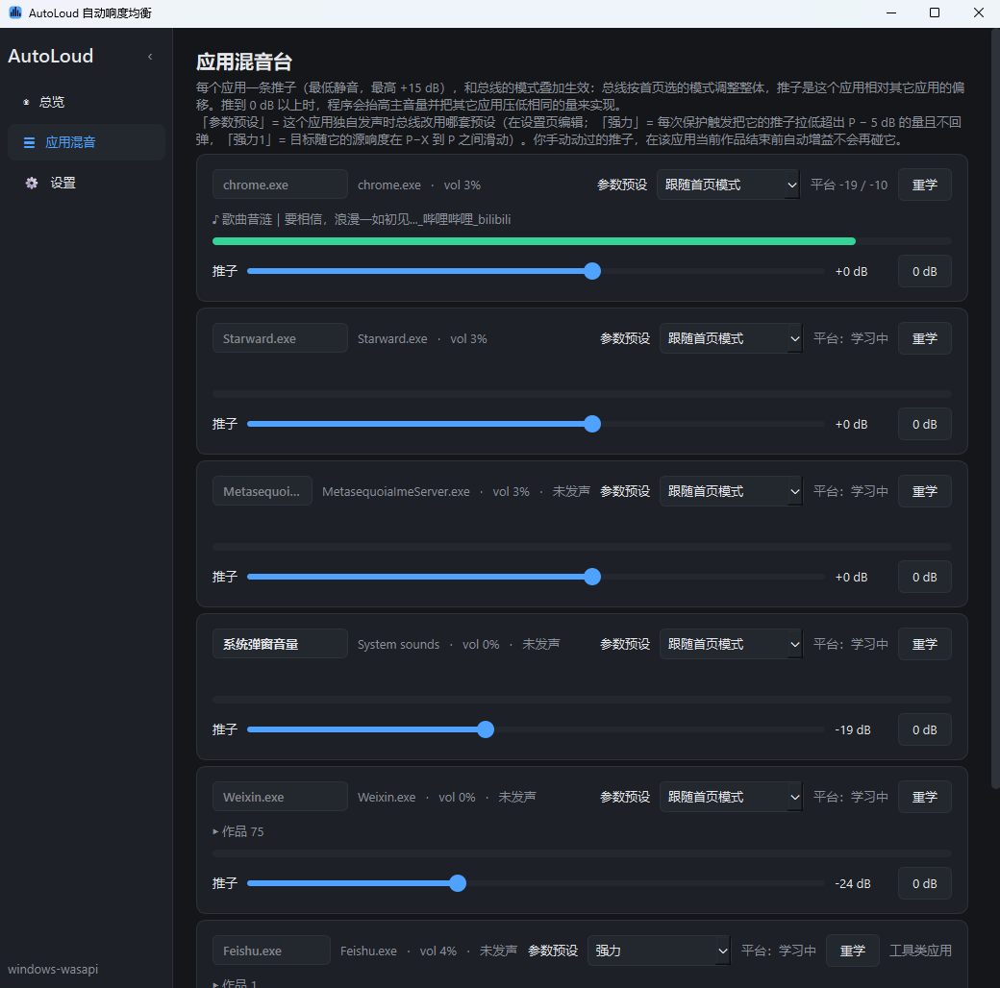
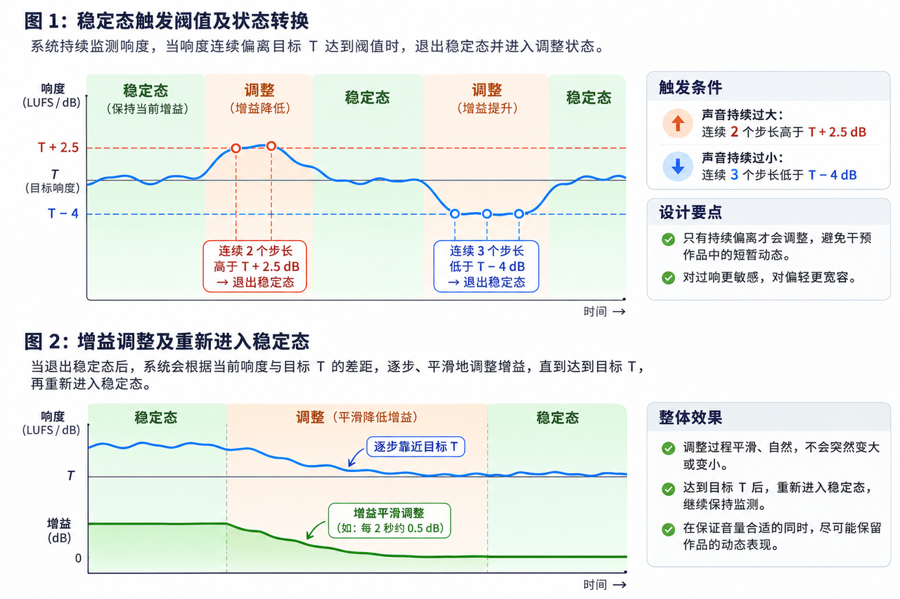
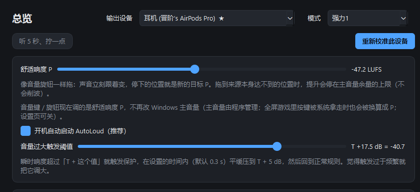
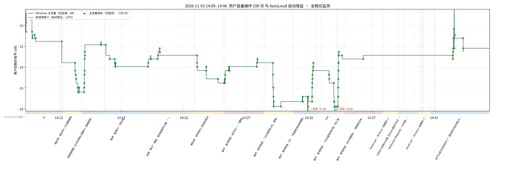
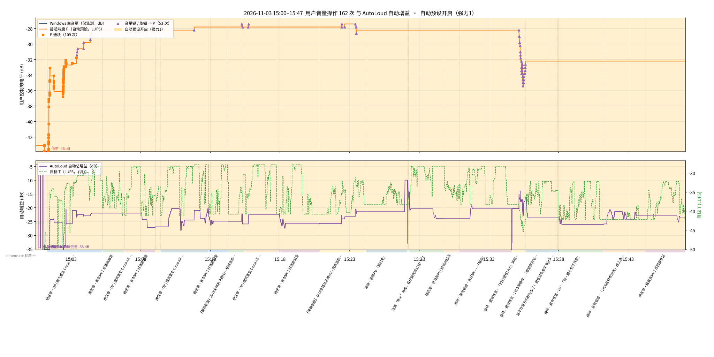

<div align="center">

# AutoLoud

### 让音量从反复调整，到始终舒适。

**告别反复调整音量，从此您只需要享受声音。**

*You adjust once. We handle the rest.*

[简体中文](README.md) · [English](README.en.md) · [下载最新版本](https://github.com/SparrowReivun/AutoLoud/releases) · [反馈问题](https://github.com/SparrowReivun/AutoLoud/issues)

</div>

## Why AutoLoud?

你有没有想过，我们每天要调整多少次音量？

每一次切换视频和音乐，每一次切换游戏场景，我们似乎总是在听不清对白和音乐太吵之间循环。更不用说那些一响起来，整个办公室都能听到的微信通知。

一个多世纪以来，我们一直在使用音量控制，反复进行着音量的加减。而大多数时候，我们的目的只有一个：

**让声音听起来舒适。**

既然如此，为什么我们不能直接告诉设备自己喜欢的音量，让它帮我们完成剩下的工作呢？

这就是 AutoLoud 想要解决的问题。

无需改变任何习惯，您仍然像平时一样，通过音量按键调整声音。不同的是，这一次，我们不仅会改变当前的音量，还会把您的喜好记在心里：

> **“这就是您喜欢的音量。”**

AutoLoud 将成为您的声音管家，持续学习并记录您的听音偏好，自动适应不同内容的响度差异并调整音量，尽可能带来舒适、沉浸的听音体验。

*“Every volume adjustment teaches your device what you like.”*

---

## 下载与安装

1. 前往 [Releases](https://github.com/SparrowReivun/AutoLoud/releases) 下载最新的 `AutoLoud-windows.zip`（约 100 MB，无需安装 Python）。
2. 将压缩包解压到任意文件夹，运行其中的 `AutoLoud.exe`。**请保留完整的解压文件夹**，不要单独移动 `exe`，因为程序还需要其旁边的其他文件。
3. 初次启动前，建议先连接好耳机、音箱等播放设备，并确认能够正常播放声音。按照软件提示完成初次设置即可开始使用。

**首次运行及安全提醒：** Windows SmartScreen 可能提示“Windows 已保护你的电脑”。请先确认下载来源为本项目的官方 Releases，并核对文件来源；确认信任后，可以通过“更多信息 → 仍要运行”继续启动。

**关于杀毒软件报毒：** 目前开发阶段，AutoLoud 正在申请代码签名。由于程序需要监听音量按键、采集系统回录音频并控制不同应用的音量，Windows Defender、360 等杀毒软件的启发式检测可能产生误报。本项目开源，欢迎检查源码，或通过 [VirusTotal](https://www.virustotal.com/) 自行检查下载文件；如果仍有疑虑，也可以按文末说明[从源码运行](#从源码运行开发者)。

**播放设备未被识别？** 特别是在使用蓝牙耳机时，可以先在 Windows 中切换到目标设备，再回到 AutoLoud 刷新设备列表；必要时尝试重启 AutoLoud。

**语言：** 软件会根据 Windows 显示语言自动选择中文或英文，也可以在设置页面的最后一行手动切换。


## 1. 安装与使用

AutoLoud 的设计目标之一，就是**不增加任何额外的学习成本**。

启动软件后，AutoLoud 会接管系统音量调整的部分控制逻辑，但不会改变您原本的操作习惯。您仍然只需要通过音量旋钮、键盘音量按键，或者软件内的音量推子调整声音。

AutoLoud 会将您的调整记录为**偏好响度 P（Preference Loudness）**，并在使用过程中持续学习不同应用的响度特征。

随着学习的进行，AutoLoud 会逐渐适应：

- 音乐与视频之间的响度差异；
- 游戏中对白与战斗场景之间的音量变化；
- 不同应用的响度特征；
- 不同内容中合理的动态变化；
- 部分应用中难以单独调整的通知提示音。

更重要的是，AutoLoud 并不会简单地压平所有声音。

受益于自动混音领域的相关研究成果，我们希望在控制整体响度的同时，尽可能尊重创作者的原始意图：**让安静的段落依然安静，让激烈的场景依然具有冲击力。**

此外，AutoLoud 还提供了**应用级混音台**，帮助用户独立管理不同应用的音量。



*图：应用混音台。可以为不同应用设置独立推子与控制预设。*

## 2. Background

### 2.1 音量控制的尝试

一个多世纪以来，人们一直在尝试控制声音播放的大小。早在 1902 年，就已有通过改进留声机结构来改变输出声量的专利设计 [1]。

事实上，越来越多的行业和企业已经意识到，控制响度差异、改善用户听音体验的重要性。

广播、电影和流媒体行业逐渐建立了相关的响度标准，例如 ITU-R BS.1770 与 EBU R 128 [2][3]。Apple Music、YouTube、Spotify 等平台也提供了不同程度的响度标准化功能，以减少不同音乐或视频之间的响度差异 [4][5][6]。

但这些方案仍然无法覆盖所有听音场景。例如：

- **不同应用之间的响度差异。** 在正常音量下听音乐时，微信等应用的通知提示音可能突然过大，而应用内往往不提供方便的通知音量设置。
- **作品内部过大的动态变化。** 例如《绝区零》等游戏中，用户可能觉得对白声很小，战斗音效却异常响亮；一些视频或音乐作品也可能出现类似问题。
- **跨应用、跨内容的连续播放。** 用户切换音乐、视频、游戏和其他应用时，仍然需要不断手动调整音量。

这些问题高度依赖用户自己进行修正。如果调整不够及时，不仅会打断正在进行的活动，过大的声音还可能带来听觉不适，甚至潜在的听力风险 [7]。

### 2.2 为什么不直接把所有声音调整到相同响度？

事实上，已经有一些软件和音频插件尝试通过压缩器、自动增益控制等方式解决类似问题，例如 Vocal Rider 一类的工具 [8]。

在 AutoLoud 的早期版本中，我们也尝试过类似的设计：将响度限制在用户设定的固定区间内。

但实际测试很快暴露出了问题。

**声音的动态变化本身就是作品表达的一部分。**

一首音乐应该有舒缓与高潮，一段电影应该有轻声对白与激烈场面，一款游戏也需要通过声音的变化营造沉浸感。

如果始终强制把声音维持在一个很窄的响度区间内，系统就不得不频繁调整增益。这不仅可能破坏作品原有的动态设计，还会极大地影响整体听感。

因此，我们真正需要解决的问题，并不是简单地让所有声音一样响，而是：

> **如何在尊重作品原有动态的同时，让不同内容尽可能保持在用户觉得舒适的听音范围内？**

为此，我尝试了多种不同的设计，经历了两百多个小时的开发、测试与迭代，最终形成了目前 AutoLoud 的核心方案。

它将用户偏好学习、应用响度分布建模、动态目标响度和稳定态控制结合起来，希望为日常听音中遇到的各种响度问题提供一套统一的解决方案。

*You adjust once. We handle the rest.*

## 3. 核心设计理念

AutoLoud 的长期目标，是探索并推动一种新的音量控制范式。

传统音量控制依赖用户不断发现问题并进行修正，而 AutoLoud 希望将这一过程转变为一个持续学习、主动适应用户听音目标的过程。

目前的设计主要围绕以下三个理念展开。

### 3.1 从操作驱动转向目标驱动

传统的音量控制是一种被动、反应式的操作：用户发现声音过大或过小，再通过音量按键进行修正。每一次操作通常只解决眼前的问题。

但实际上，每一次音量调整都隐含着用户的听音偏好。

AutoLoud 不再仅仅将音量调整视为一次操作，而是把它看作用户向系统提供的偏好信息。

当用户将声音调整到舒适的程度时，系统会记录当前音频与对应的响度信息，形成用户偏好响度 P，并将这一目标应用于后续播放。

换句话说，用户不再需要听到音频后反复判断“调大一点”或“调小一点”，而是在告诉设备：

> **“我希望声音听起来是这样的。”**

### 3.2 尊重创作者的原始意图

用户偏好响度 P，并不意味着所有声音都应该被调整到 P。

这是 AutoLoud 早期实验中得到的一个重要结论。

在同一个作品中，舒缓与高潮、轻声对白与激烈战斗，本来就应该有强弱之分。而用户的一次音量调整，只代表其对当前播放内容的响度偏好，并不意味着这一响度适用于整个作品。

因此，简单地围绕 P 设置一个固定的舒适响度区间，会面临一个难以调和的矛盾：

- **区间过窄：** 系统会频繁干预作品正常的响度变化，将舒缓与高潮、对白与战斗的响度拉近，破坏作品中合理的动态设计。
- **区间过宽：** 虽然能够保留作品的动态变化，却难以有效限制过大或过小的声音，无法真正解决用户需要频繁调整音量的问题。

为了解决这一矛盾，AutoLoud 引入了**动态目标响度 T（Target Loudness）**。

与将所有声音限制在固定响度区间内不同，AutoLoud 会结合应用的历史响度分布、当前声音在该分布中的相对位置，以及用户偏好 P，为不同内容动态计算合适的目标响度。

正因如此，与上述固定区间方法不同，我们希望在减少用户手动调整音量的同时，保留作品原有的动态层次：**让安静的段落依然安静，让激烈的场景依然具有冲击力，而整体响度始终尽可能符合用户的听音偏好。**

### 3.3 稳定态设计：多听少动

自动音量控制需要及时响应，但更需要克制。

如果程序始终跟随每一次响度变化进行增益调整，听感就会出现明显的波动，甚至产生不自然的“抽吸感”。

因此，AutoLoud 引入了稳定态机制。

它的核心原则可以概括为：

> **多听少动，慎提速降。**

在合理的范围内，用户通常比起声音偏大，更能接受声音暂时偏小。

因此，AutoLoud 对响度过高采取更敏感的响应策略，而对响度偏低则保持相对宽容。

当作品已经处于舒适的听音范围时，系统会尽可能减少不必要的增益调整；只有当持续的响度偏差表明当前音量确实不合适时，才会重新寻找新的稳定态。

这也是 AutoLoud 区别于简单响度限制方案的重要设计之一。

## 4. 核心技术设计

### 4.1 分应用学习，而不是使用统一的响度模型

不同应用具有不同的声音特征。

音乐播放器、视频网站、游戏以及即时通信软件，它们的响度分布和动态变化可能存在很大差异。

更进一步，即使在同一个应用中，不同作品的响度特征也可能完全不同。

理想情况下，我们希望能够针对每个作品独立学习其响度分布。

但这种方案需要存储和管理大量历史信息，而且在目前的开发条件下，我们还无法稳定地从部分应用（例如 Apple Music）获取正在播放的作品信息。

因此，当前版本选择了一种更容易实际落地的方案：

**以应用为单位学习历史响度分布，再结合用户偏好计算当前的目标响度。**

对于能够识别作品信息的场景，我们将作品信息用于辅助判断新作品的开始。

同时，我们通过应用级混音台，让用户能够独立调整不同应用的音量，缓解部分软件通知声音过大、难以单独控制的问题。

### 4.2 学习应用的源响度分布

当只有一个应用实际发声时，AutoLoud 可以回推去除全部增益影响后的源响度：`L_src`。

在此基础上，系统会逐渐学习该应用历史源响度分布中的两个参考值：

- **C_low：** 历史源响度的第 20 百分位，代表相对安静的响度水平。
- **C_high：** 历史源响度的第 80 百分位，代表相对响亮的响度水平。

这两个参考值并非固定不变，而是随着应用的使用持续更新。

学习过程按照有效发声时间计算，采用约 20 分钟的半衰期，使模型既能积累历史信息，也能逐渐适应应用的使用变化。

用户可以在混音台中查看相关参考值，并在必要时手动选择“重学”。

为了避免样本不足或历史响度分布过于集中导致的不稳定，系统还设置了相应的回退机制：

- 当应用有效学习时间不足 30 秒时，暂时使用用户偏好响度 P。
- 当 C_low 与 C_high 相距不足 1 LU 时，同样使用 P。
- 当多个应用同时发声、无法准确回推单个应用的源响度时，暂时保持之前的目标 T；如果持续 60 秒无法获得有效测量，则回退到 P。
- 如果应用内部音量被明显调小，导致源响度持续两分钟低于原有低参考值超过 6 LU，则根据这两分钟的数据重新建立参考分布。

### 4.3 根据用户偏好计算动态目标响度 T

在获得应用历史响度分布后，AutoLoud 会计算当前源响度在两个参考值之间的相对位置：

$$
u=\operatorname{clip}\left(\frac{L_{\mathrm{src}}-C_{\mathrm{low}}}{C_{\mathrm{high}}-C_{\mathrm{low}}},0,1\right)
$$

其中，`clip` 表示将结果限制在 0 到 1 之间。

随后，根据用户偏好响度 P 和预设的动态范围参数 X，计算目标响度 T：

$$
T=(P-X)+X\cdot u
$$

| 参数 | 含义 |
| --- | --- |
| P | 用户偏好响度（Preference Loudness） |
| X | 允许目标响度低于 P 的最大差值 |
| L_src | 去除增益影响后的应用源响度 |
| C_low | 应用历史源响度的第 20 百分位 |
| C_high | 应用历史源响度的第 80 百分位 |
| u | 当前源响度在两个参考值之间的相对位置 |
| T | 当前目标响度（Target Loudness） |

由此：

- 当声音接近应用的安静参考值时，目标响度接近 P − X。
- 当声音接近应用的响亮参考值时，目标响度接近 P。
- 即使当前源响度进一步增大，目标响度也不会超过 P。

需要特别说明，**这里限制的是目标响度，而不是每个瞬间实际输出声音的硬性上限。** 实际增益调整还受到后面介绍的稳定态机制约束。

#### 示例计算

假设某个应用的历史响度参考值为：

$$
C_{\mathrm{low}}=-25\ \mathrm{LUFS}, \qquad C_{\mathrm{high}}=-17\ \mathrm{LUFS}
$$

两者相距 8 LU。则当前源响度的相对位置为：

$$
u=\operatorname{clip}\left(\frac{L_{\mathrm{src}}+25}{8},0,1\right)
$$

假设用户偏好响度为：

$$
P=-25\ \mathrm{LUFS}, \qquad X=6\ \mathrm{LU}
$$

则目标响度为：

$$
T=-31+6u
$$

| 当前源响度 | 相对位置 u | 目标响度 T |
| --- | ---: | ---: |
| −25 LUFS | 0 | −31 LUFS |
| −23 LUFS | 0.25 | −29.5 LUFS |
| −21 LUFS | 0.5 | −28 LUFS |
| −19 LUFS | 0.75 | −26.5 LUFS |
| −17 LUFS | 1 | −25 LUFS |
| −5 LUFS | 1 | −25 LUFS |

因此，无论应用源响度如何变化，**计算得到的目标 T 始终位于 [P − X, P] 区间内。**

这种设计使得系统能够在降低整体响度差异的同时，保留不同段落之间的相对强弱关系。

### 4.4 稳定态控制

仅仅引入动态目标响度 T，还不足以保证稳定、自然的听音体验。

问题在于：目标响度的变化，并不意味着系统每次都需要立即调整音量。如果程序始终跟随 T 的变化调整增益，频繁的音量波动，尤其是增益反复升降，会明显破坏听音的连贯性与沉浸感。

因此，我们还需要判断：

**当前的响度变化，是作品正常的动态表达，还是确实需要调整的音量问题？**

为此，AutoLoud 引入了**稳定态机制（Steady-State Mechanism）**。

#### 稳定态：多听少动

稳定态是指当前声音已处于用户舒适的听音范围内，暂时不需要调整音量的状态。

在稳定态下，AutoLoud 会持续监测响度，但不会对每一次变化都做出反应。只要没有出现持续、明显的响度偏差，系统就会保持当前增益，尽可能保留作品原有的动态变化。

目前，当用户主动调整音量，或开始播放新作品时，系统都会默认进入稳定态。

#### 何时需要重新调整？

AutoLoud 持续监测声音的瞬时响度（400 ms），并以 2 秒为步长分析响度变化。

只有出现以下情况，才会退出稳定态，重新调整音量：

| 情况 | 触发条件 |
| --- | --- |
| 声音持续过大 | 连续 2 个步长高于 T + 2.5 dB |
| 声音持续过小 | 连续 3 个步长低于 T − 4 dB |

这一设计有两个关键点：

- **区分持续偏差与短暂动态。** 只有响度连续偏离目标，才会触发调整，避免将作品正常的动态变化误判为音量问题。
- **对过响更敏感，对偏轻更宽容。** 根据实际听音体验，在一定范围内，声音暂时偏小通常比突然过大更容易接受。

#### 脱离稳定态后的调整

一旦退出稳定态，AutoLoud 就会根据当前响度与目标 T 的差距，逐步、平滑地调整增益，直到达到目标 T，再重新进入稳定态。

这样既能及时修正持续的响度偏差，又能避免突然或反复的音量变化。



*图：上半部分展示持续偏响或偏轻时退出稳定态；下半部分展示平滑调整增益、重新进入稳定态的过程。曲线为机制示意，并非实测数据。*

**动态目标响度 T 决定声音应该有多响，稳定态机制则决定什么时候真正需要调整。**

两者结合，让 AutoLoud 能够遵循一个简单的原则：

> **需要调整时及时介入，不需要调整时尽量不打扰。**

在目前的个人测试中，以 2 秒为周期、每次约 0.5 dB 的平滑增益提升，以及以 2 秒为周期、每次约 1 dB 的平滑增益衰减，通常不会造成明显的听音干扰。相关参数仍在持续测试和优化中。

### 4.5 过响保护

**尽可能保护用户的听力，是 AutoLoud 始终坚持的设计原则。**

相信很多人都有过这样的经历：正在舒适地听音乐，某个应用却突然发出震耳欲聋的通知声。

为了应对这类问题，AutoLoud 设计了独立的**过响保护机制（Over-Loudness Protection）**，其优先级高于所有常规响度调整规则。

一旦检测到声音超过预设的过响阈值，系统便会立即触发保护，在约 0.05 秒内快速降低增益，并将音量维持在较低水平。

需要说明的是，这一机制无法完全消除突发声音的冲击，也不能替代专业的听力保护措施，但希望尽可能减轻意外过响带来的不适。数字音频响度阈值也不等同于实际声压级的安全界限。

默认保护阈值设置得较为保守。如果您觉得保护触发过于频繁，也可以根据自己的听音习惯适当调整。



*图：在总览页面调整过响保护阈值。*

### 4.6 更多实现细节

除了上述核心机制，AutoLoud 还包含应用音量变化检测、历史响度学习的重置与恢复、状态间的平滑切换，以及大量经过实际听音测试的参数优化。

这些细节同样对最终的听音体验至关重要，但限于篇幅，这里不再逐一展开。

## 5. 测试与实际体验

在最近几周的开发中，我花费了两百多个小时，不断测试、调整和改进各种音量控制方案。

期间，我放弃了不少最初看起来合理、实际听起来却并不理想的设计，最终迭代出了目前比较满意的两个版本，并在音乐、视频和游戏等场景中进行了累计数十小时的实际使用测试。

**最让我满意的变化，是我终于不再需要频繁调整音量了。**

过去，连续使用几个小时电脑，我可能需要调整上百次音量。而现在，在目前测试过的场景中，我通常只需要在开机时调整一次，就能连续使用几个小时，几乎不需要再手动干预。

这正是我最初希望 AutoLoud 实现的体验：

**简化音量调整，专心享受声音。**

此外，在一组播放相同内容的小规模对照测试中，我们记录到用户需要手动调整音量的次数从 **24 次下降到 6 次，减少了 75%**。


*图：相同内容对照测试中记录的手动调音次数。24 → 6，减少 75%。这一结果仅代表本次小规模测试。*

我们还记录了使用“仅监测”与“自动调整”模式时的音量操作和系统增益变化。下面展示两段独立测试的原始可视化记录，便于进一步了解系统的运行情况。

<details>
<summary><strong>查看原始测试曲线（点击展开）</strong></summary>

**仅监测模式：** 记录 Windows 主音量与用户手动调音操作，AutoLoud 不自动施加增益。



**AutoLoud 自动调整模式：** 同时记录用户音量操作、自动增益及目标响度变化。



> 注：这两段日志显示的是独立运行场次，测试时长和图中统计的全部操作口径与上面的“24 次 → 6 次”汇总不同，不能直接用图中的操作计数来计算该 75% 指标。

</details>

当然，目前的测试结果主要来自我的个人使用体验，以及小范围的用户测试。我也期待通过更多用户的实际反馈，进一步验证和改进这套方案。

## 6. 已知不足与未来计划

AutoLoud 目前仍处于开发与测试阶段，还有很多需要改进的地方。

### 6.1 全新应用需要短暂学习

首次使用一个新应用时，AutoLoud 尚不了解它的响度特征，因此有时仍需要用户手动调整一次音量。

在积累至少 30 秒的有效音频数据后，系统便可以开始使用学习得到的响度分布，控制效果通常会逐渐改善。

### 6.2 对大动态音乐的处理仍有提升空间

对于古典交响乐等动态范围较大的作品，当前版本偶尔会出现过度调整的问题，影响作品原有的动态表现。

如何更好地保留这类作品的动态层次，是下一阶段的重点优化方向之一。

测试参考：[古典交响乐音频示例](https://www.bilibili.com/video/BV1Vg3uzoEK5?t=8.2)

### 6.3 部分音频设备切换问题

目前频繁切换音频输出设备，特别是蓝牙耳机时，偶尔可能出现 AutoLoud 无法及时识别设备的情况。这可能与 Windows 音频设备接口及设备状态更新有关。

如果遇到这一问题，可以尝试先在 Windows 中手动切换至蓝牙耳机，再返回 AutoLoud 刷新设备列表；如果仍未恢复，可以尝试重启软件。

### 6.4 进一步降低调整延迟

目前，AutoLoud 主要根据已经播放的音频进行实时分析和调整，因此不可避免地存在一定的响应延迟。

未来，我们希望探索在技术和系统权限允许的情况下，提前获取尚未播放的音频缓冲数据，在声音实际输出前预测响度变化。

这有望进一步减少调整延迟，让整个控制过程更加及时、平滑，甚至让用户完全感受不到音量调整的存在。

### 6.5 支持更多操作系统

目前 AutoLoud 仅提供 Windows 版本。

我们对未来支持 macOS、Linux 等其他平台持开放态度，也非常欢迎对此感兴趣的开发者与研究者加入讨论或合作。

联系方式：

- [jinjie.shi@qmul.ac.uk](mailto:jinjie.shi@qmul.ac.uk)
- [joshua.reiss@qmul.ac.uk](mailto:joshua.reiss@qmul.ac.uk)

## 7. 使用建议与反馈

如果您觉得 AutoLoud 对日常使用有所帮助，推荐在软件主页开启 **“开机自动启动 AutoLoud”**，这样就不需要每次开机后再手动启动软件。

AutoLoud 仍然是一个不断改进中的项目。我们非常欢迎大家分享使用体验，尤其是那些 AutoLoud 还无法正确处理的声音场景。

无论是某首音乐、一款游戏、一段视频，还是某个恼人的应用提示音，您的反馈都可能帮助我们发现新的问题，让 AutoLoud 变得更好。

欢迎通过[电子邮件](mailto:jinjie.shi@qmul.ac.uk)与我们联系，或通过 [GitHub Issues](https://github.com/SparrowReivun/AutoLoud/issues) 提交问题和建议！

## 最后

作为一个时常被音乐打动的人，以及一个自动混音研究者，我一直希望，自动混音领域的研究成果不仅能够服务于专业音频制作，也能够真正改善普通人的日常听音体验。

我们已经拥有越来越先进的音频处理技术，但在最基础的音量控制上，很多时候仍然需要不断手动干预。

我希望 AutoLoud 能够成为改变这一现状的一次尝试。

让我们把注意力重新放回真正重要的事情上：**专心享受音乐、电影和游戏的美好。**

**AutoLoud — 从此您只需要享受声音。**

---

## 从源码运行（开发者）

在仓库根目录运行：

```bash
pip install -r requirements.txt
python run.py
```

运行测试：

```bash
pip install -r requirements-dev.txt
pytest
```

程序使用 Windows WASAPI 回录进行系统声音分析，通过 Windows 音频会话接口进行音量控制。更多实现细节可参阅仓库中的 `autoloud/`、`tools/` 和 `tests/` 目录。

<details>
<summary><strong>查看日志及数据分析说明</strong></summary>

- `autoloud.log`：运行日志。
- `adjust-<时间>.log`：音量控制决策记录。
- `meters-<时间>.csv`：系统瞬时、短时响度、增益、状态、目标响度等实时测量结果。
- `apps-<时间>.csv`：各应用的会话音量与源响度相关数据。
- `volume-<时间>.csv`：用户音量操作及当前模式，可用于统计手动调整次数。

日志通常保存于程序目录的 `logs/` 下；如果目录不可写，则可能回退至 `%APPDATA%\AutoLoud\`。

使用 `python tools/plot_volume.py` 可以绘制用户音量操作与自动增益曲线；`python tools/plot_app.py <应用进程名>` 可查看特定应用的历史曲线。绘图工具需要 `pandas` 和 `matplotlib`。

</details>

## References

[1] Berliner, E. (1902). *Gramophone*. U.S. Patent No. 692,502. [Library of Congress](https://www.loc.gov/resource/berl.11010127/).

[2] International Telecommunication Union. *Recommendation ITU-R BS.1770: Algorithms to Measure Audio Programme Loudness and True-Peak Audio Level*. [ITU](https://www.itu.int/rec/R-REC-BS.1770/en).

[3] European Broadcasting Union. *EBU R 128: Loudness Normalisation and Permitted Maximum Level of Audio Signals*. [EBU](https://tech.ebu.ch/publications/r128).

[4] Apple Support. *Use Sound Check in Apple Music*. [Apple](https://support.apple.com/en-us/109331).

[5] YouTube Help. *Control video volume — Stable volume*. [YouTube](https://support.google.com/youtube/answer/14106294).

[6] Spotify for Artists. *Loudness normalization on Spotify*. [Spotify](https://support.spotify.com/us/artists/article/loudness-normalization/).

[7] World Health Organization. *Deafness and hearing loss: Safe listening*. [WHO](https://www.who.int/news-room/questions-and-answers/item/deafness-and-hearing-loss-safe-listening).

[8] Waves Audio. *Riding Vocals with Vocal Rider*. [Waves](https://www.waves.com/riding-vocals-with-vocal-rider).

## 许可

[CC BY-NC 4.0](LICENSE) — 可依照许可证条款使用、修改和分享，需署名，禁止未经许可的商业使用。仓库内置的示例音频可能另有使用范围限制，请以仓库说明为准。

AutoLoud 基于 QMUL C4DM（Centre for Digital Music）的自动混音研究。
