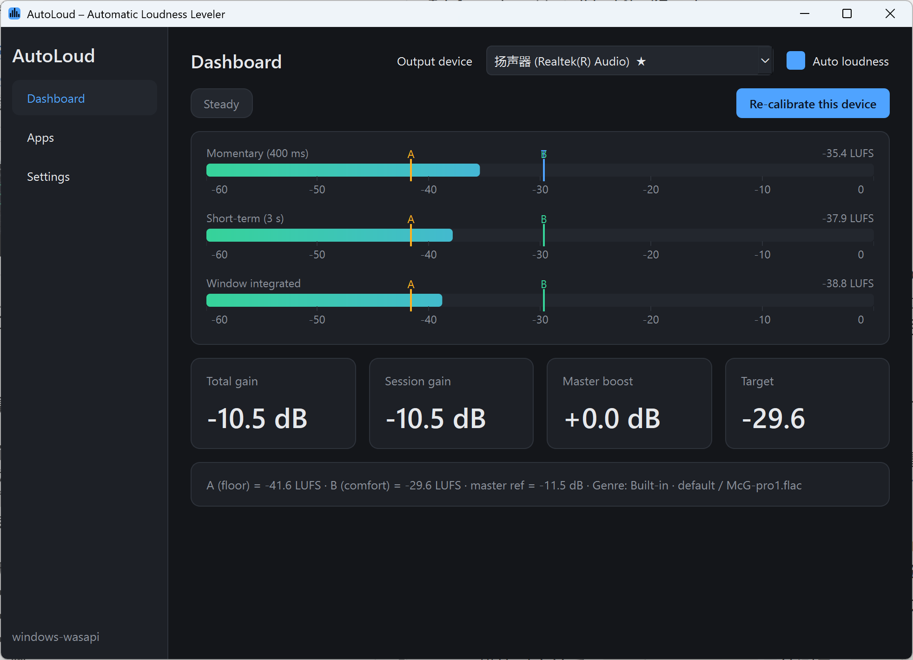

# AutoLoud

**校准一次，之后切换任何视频 / 应用都不用再碰音量。**

AutoLoud 把 Windows 上所有声音自动拉平到你自己校准出来的舒适响度。它不装驱动、不改音频流，只是实时测量系统输出有多响（ITU-R BS.1770 LUFS），再悄悄调整每个应用的音量把结果对准目标。

> English: see [README.en.md](README.en.md). 界面语言首次启动时跟随系统语言，可在「设置」里切换。



## 下载与安装

1. 到 [Releases](../../releases) 下载最新的 `AutoLoud.exe`（单文件，约 100 MB，无需安装 Python）。
2. 双击运行。首次启动 Windows SmartScreen 可能提示「Windows 已保护你的电脑」——点「更多信息 → 仍要运行」。exe 未做代码签名，这是正常现象。
3. 程序会自动打开校准向导，两分钟完成。之后它会缩到托盘里安静工作。

## 它解决什么问题

不同视频、应用的音量差异很大：一个视频开着正好，切到下一个要么轰耳朵要么听不见；通话里突然弹出的提示音吓一跳。AutoLoud 的做法：

- **起始保护**：从完全安静到有声音出现时，先按「舒适值 B − 5 dB」播放，用一个步长（默认 5 秒）平滑升到 B；这期间只压不抬，安静的片头不会被猛推。突然出现的大音量铃声不会炸耳。
- **听一段、拧一点**：之后每听满 5 秒决定一次：偏轻最多加 1 dB；偏响最多减 0.8 dB，新作品的第一次偏响则一步到位；离 B 不到 2 dB 时一步直接到位；每步的渐变时间 = 一个步长；比 B 高不到 3 dB、或低不到 8 dB 就算舒适，停下。
- **舒服以后不追着调**：轻声对白、间奏、渐弱都让它自然变轻；只有连续 2 段都超过 B + 6 dB、或连续 3 段都低于 B − 20 dB，才重新开始调。
- **新作品接着上次**：切歌 / 切视频（系统媒体信息，或 15 秒静音后再出声）时，直接接上这个应用上次的音量，再按上面的方法微调；没见过的应用才走起始保护。（按一次只有一个应用在响来设计。）
- **突然特别响**：瞬时响度超过 B + 13 dB（首页可调）就在 0.3 秒内（可调）平缓压到 B + 5 dB，稳住后自动回到正常规则继续微调。没有弹窗。
- **工具类应用自动排除**：活动但几乎不出声的会话（输入法按键音、通知助手）会被标为「工具类应用」，不参与响度控制也不干扰判断。
- **模式与强力模式**：首页选一套参数预设作为当前「模式」（比如默认 / 强力，预设在设置页新建）；混音台里每个应用可以单独勾「强力模式」——它的峰值不得超过 B − 5 dB：推子先拉到 −10 dB（有历史峰值则按记录算），之后每触发一次保护再往下拉。
- **应用混音台**：每个发声的应用一条推子（最低静音、最高 +15 dB），叠加在总线之上；推子高于 0 dB 时通过抬高主音量、压低其它应用来实现。
- **音量键调 B**：键盘的音量键 / 外接音量旋钮默认改为调节舒适响度 B（每按一下 1 dB），不再动 Windows 主音量；可在设置里关闭。
- **一切恢复**：退出时，所有应用音量和主音量回到原样。

## 校准

只有一步：先把外部设备（耳机放大器 / 音箱 / 蓝牙耳机）和 Windows 主音量都放到 80% 左右，然后播放一首你喜欢的音乐——内置曲目，或先在任意应用（Spotify、浏览器…）播放再在向导里选中它——把推子从 0 慢慢拉高，停在你觉得舒适的听音音量。这就是「舒适值 B」。

每个输出设备（耳机 / 音箱 / 蓝牙）各自保存一套校准。校准之后不要再动外部设备和主音量——AutoLoud 以它们为基准；B 随时可以在总览页的滑块上微调。

## 从源码运行 / 打包

需要 Python 3.10+。在 PowerShell 里：

```
.\dev.bat                # 建虚拟环境、装依赖、从源码运行
.\build.bat              # 打包成 dist\AutoLoud.exe
python run.py --mock     # 任何系统：用软件模拟器跑界面（没有真实声卡也能开发）
python -m pytest -q      # 单元测试：LUFS 对拍、控制器闭环仿真
```

推到 GitHub 后，`.github/workflows/build.yml` 会在每次 push 时跑测试并在 Windows 上打包；打 `v*` 标签会自动发布 Release 并附上 exe。

## 工作原理（给开发者）

```
Windows 音频引擎 ──► 各应用会话混音 ──► WASAPI loopback 回录 ──► BS.1770 LUFS 实时测量
                          ▲                                                   │
                          │ ISimpleAudioVolume（每个应用的会话音量，≤ 0 dB）     │
                          └──────────────── 增益控制器 ◄───────────────────────┘
                                             │
                     IAudioEndpointVolume（主音量，只在需要“提升”时高于校准参考值）
```

- `autoloud/dsp/loudness.py` — 流式 BS.1770-4：K 加权、瞬时 / 短时 / 带门限的积分响度，与 pyloudnorm 对拍误差 < 0.2 LU。
- `autoloud/core/controller.py` — 纯逻辑的增益控制器（IDLE → ONSET → STEADY，三条规则），可离线仿真。
- `autoloud/core/engine.py` — 回录 → 测量 → 决策 → 下发音量；主音量可见性探测。
- `autoloud/backends/windows.py` — PyAudioWPatch（loopback）+ pycaw（音量）；所有 COM 调用集中在一个线程。
- `autoloud/backends/mock.py` — 同接口的软件模拟器。
- `autoloud/ui/` — PySide6 界面：总览、校准向导、应用混音、设置、托盘。

这条「监听 + 控制音量」路线不替换音频流，所以做不了逐采样的限幅 / 压缩；换来的是免驱动、零延迟，并且天然知道是哪个应用在发声。`Backend` 接口已为将来的虚拟声卡后端预留。

## 已知问题与路线图

- 蓝牙耳机的主音量在设备端生效，回录看不到；程序会在校准时自动探测并按「不可见」处理，但探测信号仍待改稳。
- 自动混音（通话优先、音乐让路）将建立在现有的每应用偏移之上。
- 按曲目 / 视频识别来源（Windows Media Session API），切歌时重置分析窗。

## 日志

`%APPDATA%\AutoLoud\` 下：`autoloud.log` 是运行日志；`adjust-<时间>.log` 是每次运行的音量决策记录，和首页活动卡片同样的措辞，每行附当时在发声的应用（不含音量），保留 14 天。

## 许可

[CC BY-NC 4.0](LICENSE) — 可自由使用、修改、分享，须署名，禁止商用。内置示例曲目 `McG-pro1` 仅供校准演示。
