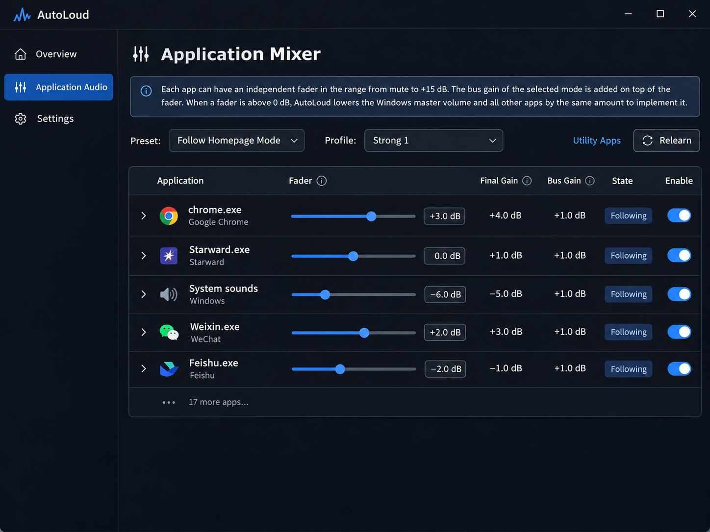
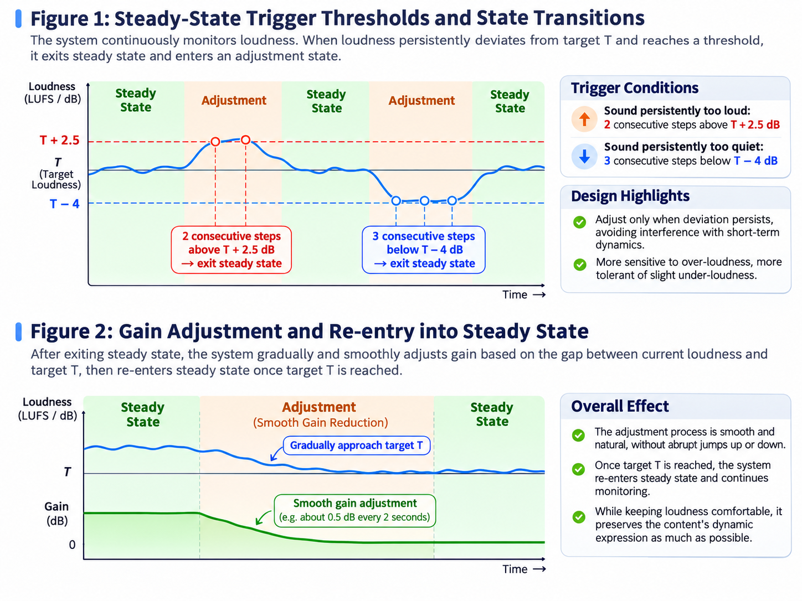
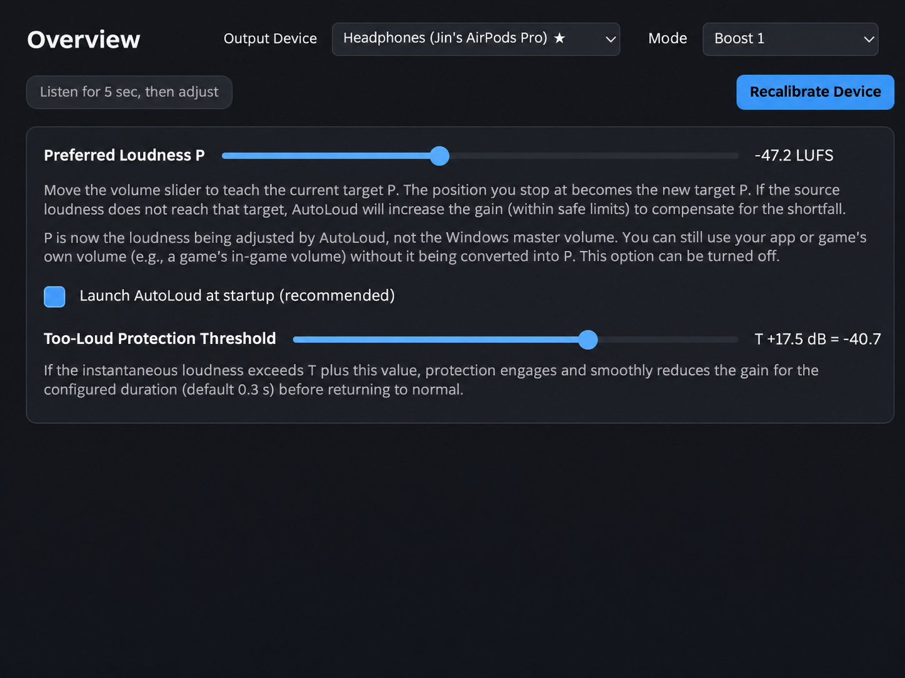
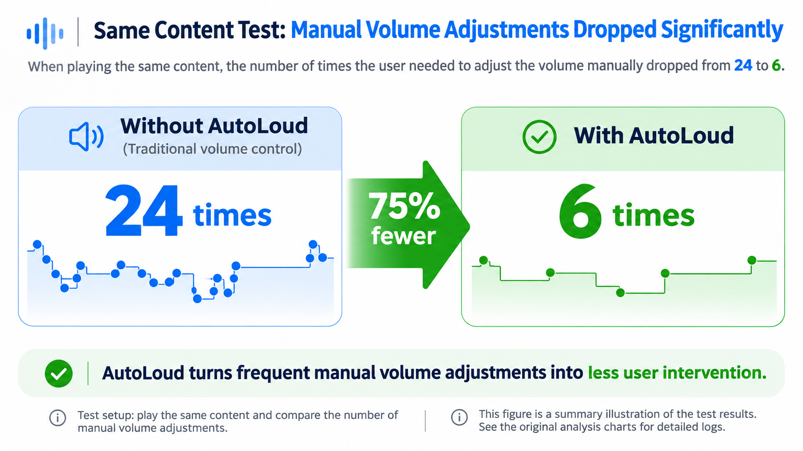
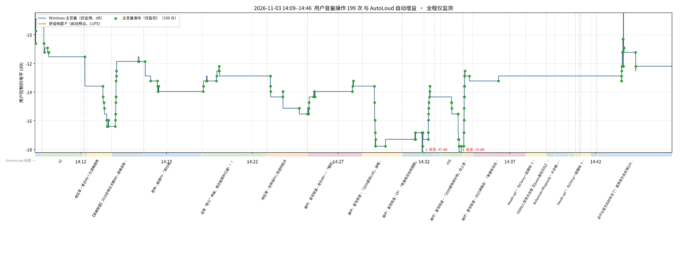
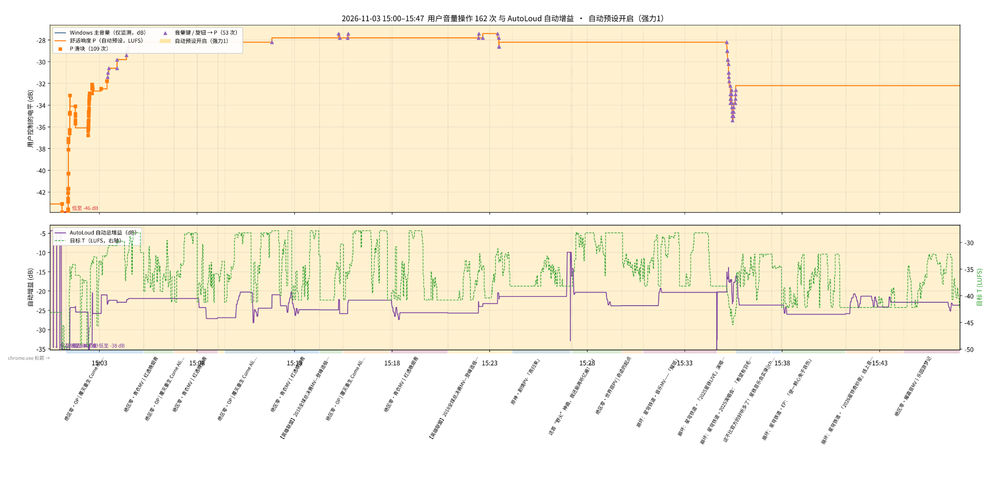

<div align="center">

# AutoLoud

### От бесконечной регулировки громкости — к комфортному прослушиванию.

**Больше не отвлекайтесь на громкость. Просто наслаждайтесь звуком.**

*You adjust once. We handle the rest.*

[简体中文](README.md) · [English](README.en.md) · [日本語](README.ja.md) · [한국어](README.ko.md) · [**Русский**](README.ru.md) · [Скачать последнюю версию](https://github.com/SparrowReivun/AutoLoud/releases) · [Сообщить о проблеме](https://github.com/SparrowReivun/AutoLoud/issues)

</div>

## Why AutoLoud?

Вы когда-нибудь задумывались, сколько раз в день приходится менять громкость?

При переключении между видео и музыкой, при смене сцен в игре мы снова и снова сталкиваемся с одной и той же проблемой: диалоги едва слышны, а музыка слишком громкая. Не говоря уже об уведомлениях WeChat, которые слышит весь офис.

Более века мы пользуемся регуляторами громкости, постоянно прибавляя и убавляя звук. И почти всегда делаем это ради одной простой цели:

**Чтобы слушать было комфортно.**

Так почему бы просто не сообщить устройству, какая громкость нам нравится, и не поручить ему всё остальное?

Именно эту задачу решает AutoLoud.

Менять привычки не придётся. Пользуйтесь клавишами громкости, как обычно. Но теперь каждое действие не только изменяет текущую громкость, но и сообщает AutoLoud о ваших предпочтениях:

> **«Вот такая громкость мне нравится».**

AutoLoud становится вашим персональным помощником по звуку: постоянно изучает и запоминает ваши предпочтения, адаптируется к различиям в громкости разных материалов и регулирует звук, чтобы вы могли сосредоточиться на музыке, видео или игре.

*“Every volume adjustment teaches your device what you like.”*

---

## Загрузка и установка

1. Откройте [Releases](https://github.com/SparrowReivun/AutoLoud/releases) и скачайте последнюю версию `AutoLoud-windows.zip` (около 100 МБ; Python устанавливать не нужно).
2. Распакуйте архив в любую папку и запустите `AutoLoud.exe`. **Не перемещайте исполняемый файл отдельно от остальных**: для работы нужны файлы рядом с ним.
3. Перед первым запуском подключите наушники или колонки и убедитесь, что звук воспроизводится нормально. Затем выполните первоначальную настройку по подсказкам программы.

**Предупреждение при первом запуске:** Windows SmartScreen может показать сообщение «Система Windows защитила ваш компьютер». Сначала убедитесь, что файл скачан из официального раздела Releases этого проекта, и проверьте его происхождение. Если вы доверяете файлу, можно выбрать «Подробнее → Выполнить в любом случае».

**Предупреждения антивирусов:** AutoLoud сейчас проходит процесс получения цифровой подписи. Программа отслеживает нажатия клавиш громкости, захватывает системный звук через loopback и управляет громкостью отдельных приложений. Из-за этого эвристические механизмы Microsoft Defender, 360 и других антивирусов могут ошибочно считать её подозрительной. Исходный код открыт: его можно изучить, проверить скачанный файл через [VirusTotal](https://www.virustotal.com/) или [запустить проект из исходников](#запуск-из-исходниковдля-разработчиков), если вам так спокойнее.

**Не определяется устройство вывода?** Это особенно часто случается с Bluetooth-наушниками. Сначала переключитесь на нужное устройство в Windows, затем обновите список устройств в AutoLoud. При необходимости перезапустите программу.

**Язык:** AutoLoud автоматически выбирает китайский или английский язык в соответствии с языком интерфейса Windows. Изменить его вручную можно в последней строке страницы настроек.


## 1. Начало работы

Одна из целей AutoLoud — **никакого дополнительного обучения**.

После запуска AutoLoud берёт на себя часть управления системной громкостью, но не меняет привычный способ взаимодействия. Вы по-прежнему можете использовать физический регулятор, клавиши громкости или ползунки в программе.

AutoLoud интерпретирует ваши изменения как **предпочитаемую громкость P (Preference Loudness)** и постепенно изучает особенности звучания каждого приложения.

Со временем система адаптируется к:

- различиям в громкости музыки и видео;
- тихим диалогам и громким боям в играх;
- типичному уровню звука отдельных приложений;
- естественным динамическим изменениям внутри произведений;
- уведомлениям, громкость которых сложно настроить отдельно.

При этом AutoLoud **не пытается сделать все звуки одинаково громкими**.

Опираясь на исследования в области автоматического микширования, мы стремимся контролировать общую громкость и как можно лучше сохранять замысел авторов: **тихие эпизоды должны оставаться тихими, а напряжённые сцены — сохранять свою выразительность**.

В программе также есть **микшер отдельных приложений**, позволяющий регулировать их громкость независимо друг от друга.



*Иллюстрация: индивидуальные фейдеры и пресеты управления для каждого приложения.*

## 2. Предыстория

### 2.1 Как развивалось управление громкостью

Люди пытаются регулировать громкость воспроизводимого звука уже более века. Ещё в 1902 году в патенте на граммофон описывалась конструкция, позволяющая изменять громкость его звучания [1].

Сегодня всё больше отраслей и компаний осознают важность уменьшения перепадов громкости и повышения комфорта слушателей.

В вещании, кино и стриминге появились стандарты измерения и нормализации громкости, включая ITU-R BS.1770 и EBU R 128 [2][3]. Apple Music, YouTube и Spotify предлагают разные функции нормализации для уменьшения различий между песнями и видео [4][5][6].

Однако эти решения охватывают далеко не все ситуации:

- **Различия между приложениями.** Вы слушаете музыку на комфортной громкости, а уведомление WeChat внезапно звучит гораздо громче. Не во всех приложениях удобно отдельно настраивать уведомления.
- **Большие перепады внутри одного произведения.** Например, в *Zenless Zone Zero* и других играх диалоги могут казаться слишком тихими, а боевые эффекты — чрезмерно громкими. Подобное встречается и в видео или музыке.
- **Переключение между приложениями и материалами.** При переходах между музыкой, видео, играми и другими программами приходится постоянно менять громкость вручную.

В большинстве случаев исправлять такие проблемы должен сам пользователь. Это отвлекает от происходящего и может вызывать дискомфорт; при очень высоких уровнях звука возможен и риск для слуха [7].

### 2.2 Почему бы не выровнять громкость абсолютно всех звуков?

Уже существуют программы и плагины, использующие компрессию или автоматическую регулировку усиления для похожих задач, например Waves Vocal Rider [8].

В ранних версиях AutoLoud мы тоже пробовали удерживать громкость в заданном пользователем фиксированном диапазоне.

Но прослушивания выявили недостатки такого подхода.

**Динамика звука — часть художественного замысла.**

В музыке должны быть и спокойные моменты, и кульминации. В фильме — тихие реплики и напряжённые эпизоды. Игры используют изменения громкости для создания погружения.

Если принудительно удерживать все звуки в узком диапазоне, приходится постоянно менять усиление. Это может разрушать задуманную авторами динамику и делать звучание неестественным.

Поэтому наша задача не просто сделать всё одинаково громким, а ответить на вопрос:

> **Как сохранить исходную динамику произведения и при этом сделать прослушивание разных материалов максимально комфортным?**

Я испытал разные варианты, потратил более **200 часов** на разработку, прослушивания и доработку и в итоге сформировал нынешний подход AutoLoud.

Он объединяет обучение предпочтениям пользователя, моделирование распределений громкости для разных приложений, динамическую целевую громкость и управление устойчивым состоянием.

*You adjust once. We handle the rest.*

## 3. Основные принципы

Долгосрочная цель AutoLoud — исследовать новый подход к управлению громкостью.

Обычный регулятор требует от человека заметить проблему и исправить её. AutoLoud превращает этот процесс в непрерывное обучение предпочтениям и адаптацию к желаемому звучанию.

В основе решения — три принципа.

### 3.1 От отдельных действий — к цели пользователя

Традиционная регулировка реактивна: звук кажется слишком громким или тихим, и пользователь вручную его исправляет. Каждое действие решает только текущую проблему.

Но в каждом изменении громкости содержится информация о предпочтениях слушателя.

Для AutoLoud это не просто команда, а **сигнал о желаемом звучании**.

Когда пользователь выбирает комфортный уровень, система записывает характеристики текущего звука и соответствующую громкость, определяет **предпочитаемую громкость P** и использует её при последующем воспроизведении.

Вместо бесконечных «сделать немного громче» и «сделать немного тише» вы фактически говорите устройству:

> **«Я хочу, чтобы звук воспринимался именно так».**

### 3.2 Уважение к авторскому замыслу

**Предпочитаемая громкость P не означает, что любой звук нужно доводить до P.**

Это один из важнейших выводов ранних экспериментов с AutoLoud.

Спокойные и кульминационные эпизоды, тихая речь и напряжённые сражения должны отличаться по громкости. Одно ручное изменение выражает предпочтение относительно **того, что звучит сейчас**, но не задаёт идеальный уровень для всего произведения.

Поэтому фиксированный комфортный диапазон вокруг P создаёт противоречие:

- **Слишком узкий:** система постоянно вмешивается в естественные перепады, сближая тихие и громкие моменты и разрушая задуманную динамику.
- **Слишком широкий:** динамика сохраняется, но очень громкие и слишком тихие эпизоды остаются проблемой, и пользователю приходится снова менять звук вручную.

Чтобы решить эту задачу, AutoLoud вводит **динамическую целевую громкость T (Target Loudness)**.

Вместо одного неизменного диапазона он рассчитывает подходящий уровень с учётом истории громкости приложения, положения текущего звука в этом распределении и предпочтения пользователя P.

Наша цель — уменьшить количество ручных регулировок, по возможности сохранив динамику произведения: **тихие фрагменты остаются тихими, драматические — выразительными, а общий уровень лучше соответствует предпочтениям слушателя**.

### 3.3 Устойчивое состояние: больше слушать, меньше вмешиваться

Автоматическое управление должно быть достаточно быстрым, но при этом сдержанным.

Если менять усиление при каждом колебании громкости, возникнут заметные скачки и неестественный эффект «накачки» (pumping).

Поэтому AutoLoud использует механизм **устойчивого состояния (Steady State)**.

Его принцип:

> **Постоянно отслеживать звук, но вмешиваться лишь при необходимости. Повышать плавно, понижать быстрее.**

В разумных пределах временно тихий звук обычно переносится легче, чем внезапно чрезмерно громкий.

Поэтому на превышение громкости система реагирует чувствительнее, а к более тихим фрагментам относится терпимее.

Когда комфортный уровень найден, AutoLoud старается не менять усиление без причины. Поиск нового устойчивого состояния начинается лишь при длительном отклонении от цели.

## 4. Техническое устройство

### 4.1 Отдельное обучение для каждого приложения

Музыкальные проигрыватели, видеосервисы, игры и мессенджеры заметно отличаются распределением громкости и динамикой звука.

Даже внутри одного приложения разные произведения могут звучать совершенно по-разному.

В идеале хотелось бы изучать распределение каждого отдельного произведения. Но это потребовало бы большого хранилища истории, а доступные сейчас интерфейсы не позволяют надёжно получать информацию о воспроизводимом материале из некоторых приложений, например Apple Music.

Поэтому текущая версия использует более практичный подход:

**Изучать историю громкости каждого приложения, а затем сочетать её с предпочтением пользователя для расчёта текущей цели.**

Если метаданные доступны, они помогают определить начало нового произведения.

Микшер позволяет отдельно менять громкость приложений и облегчает контроль над слишком громкими уведомлениями.

### 4.2 Изучение распределения исходной громкости

Когда звук фактически воспроизводит только одно приложение, AutoLoud может оценить его исходную громкость до влияния применённых коэффициентов усиления: `L_src`.

На основании истории система постепенно изучает два опорных значения:

- **C_low:** 20-й процентиль исходной громкости — относительно тихий уровень.
- **C_high:** 80-й процентиль — относительно громкий уровень.

Эти значения не фиксированы и обновляются по мере использования приложения.

Обучение учитывает только время, когда действительно звучит аудио. Период полураспада исторических данных составляет около **20 минут**: это позволяет сохранять прошлую информацию и адаптироваться к изменениям.

Оба значения можно посмотреть в микшере и при необходимости переобучить.

Для недостаточного количества данных и нестабильных распределений предусмотрены правила:

- Если доступно менее **30 секунд** подходящих данных, временно использовать P.
- Если расстояние между C_low и C_high меньше **1 LU**, также использовать P.
- Если несколько приложений звучат одновременно и исходную громкость конкретного приложения нельзя надёжно определить, сохранять предыдущее T; после **60 секунд** без подходящих измерений вернуться к P.
- Если исходная громкость остаётся более чем на **6 LU ниже C_low в течение двух минут** (например, после изменения громкости внутри приложения), пересоздать опорное распределение по данным этих двух минут.

### 4.3 Расчёт динамической целевой громкости T

После обучения распределения AutoLoud определяет, где текущая исходная громкость находится относительно двух опорных значений:

```math
u=\mathrm{clip}\left(\frac{L_{\mathrm{src}}-C_{\mathrm{low}}}{C_{\mathrm{high}}-C_{\mathrm{low}}},0,1\right)
```

Функция `clip` ограничивает результат интервалом от 0 до 1.

Затем рассчитывается цель T из предпочтения P и параметра динамического диапазона X:

```math
T=(P-X)+X\cdot u
```

| Обозначение | Значение |
| --- | --- |
| P | Предпочитаемая громкость пользователя |
| X | Максимальная величина, на которую цель может быть ниже P |
| L_src | Исходная громкость приложения с исключённым влиянием усиления |
| C_low | 20-й процентиль исторической исходной громкости |
| C_high | 80-й процентиль исторической исходной громкости |
| u | Относительное положение текущей громкости между опорными точками |
| T | Текущая целевая громкость |

Отсюда следует:

- При приближении к тихому опорному значению T стремится к P − X.
- При приближении к громкому опорному значению T стремится к P.
- Даже если исходная громкость возрастает дальше, T не превышает P.

**Ограничивается именно целевое значение T, а не фактический выходной уровень в каждый момент времени.** Реальное изменение усиления дополнительно регулируется механизмом устойчивого состояния.

#### Пример расчёта

Допустим, опорные значения приложения равны:

```math
C_{\mathrm{low}}=-25\ \mathrm{LUFS}, \qquad C_{\mathrm{high}}=-17\ \mathrm{LUFS}
```

Разница составляет 8 LU. Тогда:

```math
u=\mathrm{clip}\left(\frac{L_{\mathrm{src}}+25}{8},0,1\right)
```

Пусть пользователь настроил:

```math
P=-25\ \mathrm{LUFS}, \qquad X=6\ \mathrm{LU}
```

Получим:

```math
T=-31+6u
```

| Текущая исходная громкость | Положение u | Цель T |
| --- | ---: | ---: |
| −25 LUFS | 0 | −31 LUFS |
| −23 LUFS | 0.25 | −29.5 LUFS |
| −21 LUFS | 0.5 | −28 LUFS |
| −19 LUFS | 0.75 | −26.5 LUFS |
| −17 LUFS | 1 | −25 LUFS |
| −5 LUFS | 1 | −25 LUFS |

Таким образом, при любой исходной громкости **рассчитанное значение T всегда находится в пределах [P − X, P]**.

Это помогает уменьшить нежелательные перепады, сохраняя относительные различия между тихими и громкими фрагментами.

### 4.4 Управление устойчивым состоянием

Одной динамической цели T недостаточно для естественного и стабильного звучания.

Изменение цели не всегда должно вызывать немедленное изменение громкости. Если постоянно подстраивать усиление под T, особенно попеременно повышая и понижая его, это нарушает непрерывность прослушивания и погружение.

Поэтому системе нужно различать **нормальную динамику произведения** и **длительное отклонение, которое действительно следует исправить**.

Для этого и нужен механизм устойчивого состояния.

#### Устойчивое состояние: меньше ненужных регулировок

Устойчивым называется состояние, в котором громкость уже находится в комфортном диапазоне и изменять усиление пока не требуется.

AutoLoud продолжает измерения, но не реагирует на каждое колебание. Пока нет заметного и устойчивого отклонения, усиление сохраняется, чтобы не нарушать естественную динамику.

Согласно текущей логике, после ручной регулировки пользователя и при начале нового произведения система по умолчанию входит в устойчивое состояние.

#### Когда нужна новая регулировка?

AutoLoud постоянно измеряет мгновенную громкость (окно **400 мс**) и оценивает изменение с шагом **2 секунды**.

Выход из устойчивого состояния происходит только при одном из следующих условий:

| Ситуация | Условие |
| --- | --- |
| Звук длительно слишком громкий | **2 последовательных шага** выше T + 2,5 dB |
| Звук длительно слишком тихий | **3 последовательных шага** ниже T − 4 dB |

У этого подхода два важных свойства:

- **Отличать длительные отклонения от коротких динамических изменений.** Коррекция начинается лишь после устойчивого отклонения от цели, чтобы краткие пики и паузы не воспринимались как неисправность громкости.
- **Чувствительнее реагировать на слишком громкий звук.** По результатам личных прослушиваний, в определённых пределах временно тихий звук воспринимался легче, чем внезапно чрезмерно громкий.

#### Что происходит после выхода из устойчивого состояния?

AutoLoud оценивает разницу между текущей громкостью и T, плавно изменяет усиление в направлении цели и, достигнув её, возвращается в устойчивое состояние.

Это помогает исправлять длительные отклонения без резких и постоянно чередующихся регулировок.



*Иллюстрация: сверху — выход из устойчивого состояния при длительном превышении или недостатке громкости; снизу — плавная регулировка усиления и возврат в устойчивое состояние. Кривые схематичны и не являются реальными измерениями.*

**Динамическая цель T определяет, насколько громким должен быть звук; управление устойчивым состоянием — когда вообще требуется вмешательство.**

Вместе они реализуют простой принцип:

> **Вмешиваться, когда нужно, и не мешать, когда всё в порядке.**

В моих личных тестах плавное повышение примерно на **0,5 dB каждые 2 секунды** и понижение примерно на **1 dB каждые 2 секунды** обычно не вызывали заметных неудобств. Параметры продолжают тестироваться и уточняться.

### 4.5 Защита от чрезмерной громкости

**По возможности уменьшать воздействие неожиданно громких звуков — один из важнейших принципов AutoLoud.**

Многим знакома ситуация: спокойно слушаешь музыку, а уведомление другого приложения внезапно звучит оглушительно.

Поэтому AutoLoud содержит отдельный **механизм защиты от чрезмерной громкости**, который имеет приоритет над обычными правилами управления звуком.

Когда измеренная громкость превышает заданный порог, защита срабатывает и быстро снижает усиление примерно за **0,05 секунды**, после чего поддерживает более низкий уровень.

Механизм не может полностью убрать первый громкий импульс и не заменяет профессиональные средства защиты слуха. Его задача — уменьшать дискомфорт от неожиданно громких звуков. Кроме того, цифровой порог громкости **не равен гарантированно безопасному уровню звукового давления у уха**.

По умолчанию порог установлен достаточно осторожно. Если защита срабатывает слишком часто, его можно скорректировать с учётом условий прослушивания.



*Иллюстрация: настройка порога защиты на главной странице программы.*

### 4.6 Прочие детали реализации

Помимо описанных механизмов, AutoLoud обнаруживает изменения громкости внутри приложений, умеет сбрасывать и восстанавливать обученные распределения, плавно переходить между состояниями и использует множество параметров, настроенных по результатам прослушиваний.

Эти детали тоже важны, но здесь мы не будем подробно разбирать их, чтобы не перегружать README.

## 5. Тестирование и опыт использования

За последние несколько недель я потратил более **200 часов** на разработку, испытания и совершенствование разных способов управления громкостью.

От многих идей, которые казались удачными, пришлось отказаться: на слух они работали неестественно. В итоге получились две версии, которыми я относительно доволен. Они прошли десятки часов личного тестирования в музыке, видео и играх.

**Больше всего меня радует, что теперь не приходится постоянно тянуться к регулятору громкости.**

Раньше за несколько часов работы за компьютером я мог изменить громкость сотни раз. С AutoLoud в проверенных сценариях часто достаточно один раз выставить комфортный уровень при запуске и затем часами почти не вмешиваться.

Именно такого результата я и добивался:

**Меньше регулировок — больше удовольствия от звука.**

В небольшом сравнительном тесте с **одинаковым контентом** мы также зафиксировали сокращение числа ручных регулировок с **24 до 6 — на 75%**.



*Иллюстрация: результаты одного небольшого сравнительного теста с одинаковым контентом. 24 → 6, снижение на 75%. Это число относится только к данному тесту.*

Дополнительно мы записали действия пользователя и изменения усиления в режимах «только мониторинг» и «автоматическая регулировка». Ниже представлены отдельные журналы испытаний.

<details>
<summary><strong>Показать исходные графики тестов</strong></summary>

**Только мониторинг:** Записываются системная громкость Windows и ручные действия пользователя; AutoLoud не меняет усиление автоматически.



**Автоматическая регулировка AutoLoud:** Записываются действия пользователя, автоматическое усиление и изменения целевой громкости.



> Примечание: Это две независимые сессии. Их длительность и способ подсчёта всех действий отличаются от сравнения «24 → 6» выше, поэтому количество событий на этих графиках нельзя напрямую использовать для вычисления показателя 75%.

</details>

Пока результаты основаны преимущественно на моём личном опыте и небольших испытаниях. Я надеюсь проверить и улучшить подход благодаря отзывам более широкого круга пользователей.

## 6. Известные ограничения и планы

AutoLoud всё ещё находится в разработке и тестировании; многое предстоит улучшить.

### 6.1 Новому приложению нужно немного времени на обучение

При первом использовании приложения AutoLoud ещё не знает распределения его громкости, поэтому иногда потребуется сначала один раз настроить звук вручную.

После накопления хотя бы **30 секунд** подходящих аудиоданных система может начать использовать обученное распределение; качество управления обычно постепенно улучшается.

### 6.2 Музыка с очень широким динамическим диапазоном

При прослушивании классических симфоний и других произведений с большой разницей между тихими и громкими фрагментами текущая версия иногда вмешивается слишком сильно и нарушает исходную динамику.

Более точное сохранение такой динамики — одна из главных задач следующего этапа.

Пример для тестирования: [фрагмент симфонической музыки](https://www.bilibili.com/video/BV1Vg3uzoEK5?t=8.2).

### 6.3 Проблемы при переключении аудиоустройств

При частом переключении устройств вывода, особенно Bluetooth-наушников, AutoLoud иногда не сразу распознаёт активное устройство. Возможно, это связано с Windows Audio API и обновлением состояния устройства.

Попробуйте сначала переключить устройство в Windows, затем обновить список в AutoLoud. Если не помогло — перезапустите программу.

### 6.4 Дальнейшее уменьшение задержки

Сейчас AutoLoud анализирует уже воспроизведённый звук, поэтому некоторая задержка реакции неизбежна.

В будущем мы хотим исследовать возможность получать данные из аудиобуфера до воспроизведения, если это позволят технология и системные разрешения. Это дало бы возможность заранее предсказывать изменения громкости.

Так управление могло бы стать быстрее, плавнее и практически незаметным.

### 6.5 Другие операционные системы

Пока AutoLoud доступен **только для Windows**.

Мы открыты к будущей поддержке macOS и Linux и будем рады обсуждению и сотрудничеству с заинтересованными разработчиками и исследователями.

Контакты:

- [jinjie.shi@qmul.ac.uk](mailto:jinjie.shi@qmul.ac.uk)
- [joshua.reiss@qmul.ac.uk](mailto:joshua.reiss@qmul.ac.uk)

## 7. Советы и обратная связь

Если AutoLoud помогает вам каждый день, рекомендуем включить на главной странице **«Запускать AutoLoud вместе с Windows»**, чтобы не открывать программу вручную после каждого включения компьютера.

AutoLoud продолжает развиваться. Мы будем рады сообщениям об опыте использования, особенно о ситуациях, в которых программа пока не справляется.

Любая песня, игра, видео или раздражающее уведомление может помочь найти новую проблему и улучшить решение.

Пишите нам по [электронной почте](mailto:jinjie.shi@qmul.ac.uk) или создавайте обращения в [GitHub Issues](https://github.com/SparrowReivun/AutoLoud/issues).

## В заключение

Как человек, которого часто трогает музыка, и как исследователь в области автоматического микширования, я давно мечтаю, чтобы достижения этой области служили не только профессиональному производству аудио, но и улучшали повседневное прослушивание для всех.

Технологии обработки звука становятся всё совершеннее, но даже такая базовая задача, как управление громкостью, всё ещё требует постоянного внимания.

Надеюсь, AutoLoud станет шагом к изменению этой ситуации.

Давайте сосредоточимся на главном: **получать удовольствие от музыки, фильмов и игр**.

**AutoLoud — меньше регулировок, больше звука и впечатлений.**

---

## Запуск из исходников (для разработчиков)

В корне репозитория выполните:

```bash
pip install -r requirements.txt
python run.py
```

Запуск тестов:

```bash
pip install -r requirements-dev.txt
pytest
```

AutoLoud использует Windows WASAPI loopback для анализа системного звука и интерфейсы аудиосессий Windows для управления громкостью. Подробнее см. каталоги `autoloud/`, `tools/` и `tests/`.

<details>
<summary><strong>Показать сведения о логах и анализе данных</strong></summary>

- `autoloud.log`: журнал работы программы.
- `adjust-<time>.log`: решения по регулировке громкости.
- `meters-<time>.csv`: измерения громкости, усиления, состояния системы и целевого значения.
- `apps-<time>.csv`: данные об уровне сессий и исходной громкости приложений.
- `volume-<time>.csv`: действия пользователя и активный режим, в том числе для подсчёта ручных регулировок.

Обычно логи хранятся в папке `logs/` рядом с программой. Если папка недоступна для записи, они могут сохраняться в `%APPDATA%\AutoLoud\`.

Команда `python tools/plot_volume.py` строит графики действий пользователя и автоматического усиления; `python tools/plot_app.py <process-name>` показывает историю конкретного приложения. Для графиков нужны `pandas` и `matplotlib`.

</details>

## References / Источники

[1] Berliner, E. (1902). *Gramophone*. U.S. Patent No. 692,502. [Library of Congress](https://www.loc.gov/resource/berl.11010127/).

[2] International Telecommunication Union. *Recommendation ITU-R BS.1770: Algorithms to Measure Audio Programme Loudness and True-Peak Audio Level*. [ITU](https://www.itu.int/rec/R-REC-BS.1770/en).

[3] European Broadcasting Union. *EBU R 128: Loudness Normalisation and Permitted Maximum Level of Audio Signals*. [EBU](https://tech.ebu.ch/publications/r128).

[4] Apple Support. *Use Sound Check in Apple Music*. [Apple](https://support.apple.com/en-us/109331).

[5] YouTube Help. *Control video volume — Stable volume*. [YouTube](https://support.google.com/youtube/answer/14106294).

[6] Spotify for Artists. *Loudness normalization on Spotify*. [Spotify](https://support.spotify.com/us/artists/article/loudness-normalization/).

[7] World Health Organization. *Deafness and hearing loss: Safe listening*. [WHO](https://www.who.int/news-room/questions-and-answers/item/deafness-and-hearing-loss-safe-listening).

[8] Waves Audio. *Riding Vocals with Vocal Rider*. [Waves](https://www.waves.com/riding-vocals-with-vocal-rider).

## Лицензия

[CC BY-NC 4.0](LICENSE) — использование, изменение и распространение допускаются при соблюдении условий лицензии и указании авторства; для коммерческого использования требуется отдельное разрешение. На демонстрационные аудиофайлы в репозитории могут распространяться дополнительные ограничения, описанные в документации.

AutoLoud основан на исследованиях автоматического микширования в QMUL C4DM (Centre for Digital Music).
